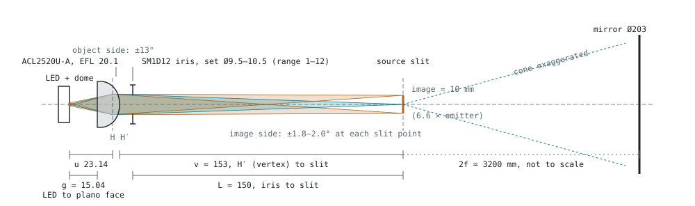

# Portable Single-Mirror Schlieren Apparatus

**Design Description**

Revision: Nov 7, 2026

This document describes the design of the apparatus, and is maintained authoritatively as Markdown fragments
in the project repo on GitHub at <https://github.com/fritzm/schlieren/tree/main/docs/design>.  It serves as
durable context for AI assistants to reason about the design, as well as being a human-readable guide.

## Conventions

- The design described here is the baseline. Unless marked otherwise, dimensions, parts, and methods are
  settled.
- **Provisional** marks a design area, dimension, or method that is still open or evolving, typically pending
  a physical fit check, measurement, or further design. Provisional areas are rolled up with next steps in
  [§11](11-open-work.md#11-provisional-areas-and-next-steps).
- Measured values, manufacturer specifications, and calculated values are identified as such where the
  distinction matters; a measured value takes precedence over a catalog value.
- Quantities, vendors, part numbers beyond those needed to define the design, procurement state, and the CAD
  state of printed parts are recorded in the associated BOM at (`bom/bom.csv`), not here.

## 1. Project context and design constraints

The apparatus is a portable, single-mirror schlieren system intended initially for several days of
vacation/travel use in a location with a large room and a substantial tabletop. It should remain useful
afterward as a bench-top laboratory instrument.

The complete system should pack into a standard airline rolling suitcase. Plan around the ordinary 50 lb / 23
kg checked-bag target.

The design is cost-conscious rather than constrained to a fixed dollar ceiling. Commodity 2020 extrusion,
Baltic-birch plywood, standard fasteners, and printed PLA are preferred where they are adequate. Commercial
optomechanics are used where they materially simplify alignment or provide precision that would otherwise be
troublesome.

### 1.1 Fabrication envelope

Near-term 3D printing is PLA only. Critical optical heights and precision datums should be established by
metal posts, optical hardware, shim stock, mechanical stops, or adjustment mechanisms rather than relying
solely on as-printed PLA dimensions.

The following are out of scope:

- custom machined parts requiring a mill or lathe;
- cutting stainless-steel stock or sheet to custom shape or length.

Use off-the-shelf metal parts, vendor-supplied finished dimensions, plywood, thin foil, or printed PLA.
Drilling and tapping of aluminum parts is within scope.

## 2. Overview and optical layout

The apparatus consists of two main physical assemblies:

1. a tabletop optical head; and
2. a separate mirror cell, normally tripod-mounted approximately 3.2 m away.

The tabletop optical head uses two independently yaw-adjustable 2020 aluminum-extrusion rails mounted to a
common Baltic-birch front pivot plate. The rails diverge slightly away from the mirror-facing end so that each
rail follows one optical chief ray:

- the source rail carries the illumination system directed toward the mirror;
- the imaging rail carries the cutoff and camera system for the return beam.

The source rail contains, in optical order:

1. light source (with interchangeable threaded LED modules, condenser lens, and adjustable iris)
2. adjustable slit fixture
3. field lens, on a post of its own just ahead of the slit ([§7](07-field-lens.md#7-field-lens))

The slit is the effective optical source, with the LED illuminating it through the condenser and iris. The
imaging rail contains, in optical order:

1. cutoff carriage at the returned slit-image plane;
2. telephoto lens in adjustable cradle;
3. iPhone attached to lens, with additional rail support.

A spherical mirror in a separate tripod-mountable cell forms an image of the source slit back near
the optical head. Refractive-index gradients in the test region near the mirror deflect portions of this
return beam relative to the cutoff, producing schlieren contrast.

This section also holds the optical design of the whole system. [§2.1](#21-primary-optic)–[2.5](#25-coordinate-frames)
give the geometry (the primary optic, the source cone, the rail offset, the optical axis and the coordinate
frames), and [§2.6](#26-condenser-and-iris)–[2.9](#29-telephoto-and-camera-optics) give the optical parameters
element by element, in the order the light meets them. The station sections that follow
([§3](03-frame.md#3-tabletop-optical-frame)–[§10](10-mirror-cell.md#10-mirror-cell)) describe the physical design
of each station and refer back here for its optics.

### 2.1 Primary optic

- Mirror: Skyoptikst D203F1600
- Diameter: 203 mm
- Focal length: 1600 mm
- Surface: spherical
- Radius of curvature / nominal operating distance: approximately 3200 mm

The source slit and imaging/cutoff system operate near the mirror center of curvature. The test region is near
the mirror, where outgoing and returning beams remain close together.

The returned slit image defines the cutoff plane.

### 2.2 Source cone

At 3200 mm, the mirror subtends a half-angle of approximately:

$$
\theta=\tan^{-1}(101.5/3200)\approx1.82^\circ
$$

The intended illumination cone is approximately ±1.82° (the mirror's half-angle, just filling it) to ±2.0°,
corresponding to approximately NA = 0.032–0.035 in air. Slight mirror overfill is preferred to underfill.

Some beam diameters of the nominal ±1.82° cone for reference:

| Distance from source slit | Approx. beam diameter |
| ------------------------- | --------------------- |
| 1 m                       | 63 mm                 |
| 2 m                       | 127 mm                |
| 3.2 m                     | 203 mm                |

The mirror's approximately f/7.9 focal ratio should not be confused with this source cone. The source operates
near 2f, at approximately the mirror center of curvature.

### 2.3 Source/imager offset

The two rail pivot centers are separated by 95 mm at the mirror-facing front plate. At 3.2 m this gives
approximately 1.70° total chief-ray separation, or rail yaw of 0.85° from the mirror normal.

Each rail points directly toward the mirror and follows its own chief ray. Sliding a fixture along a rail is
therefore predominantly an axial adjustment.

The source slit and cutoff need not occupy exactly the same axial position. Near 2f,

$$
\frac{ds_i}{ds_o}\approx -1
$$

so small source-slit displacement produces approximately equal and opposite conjugate-image displacement.
This can be an aid in avoiding mechanical interference between fixtures on opposite rails.

A useful starting point is about 30–40 mm total slit/cutoff axial staggering, obtained by placing them
approximately ±15–20 mm around nominal 2f. This is an experimental setup adjustment rather than a
fabrication-critical dimension.

### 2.4 Optical axis

The common optical axis is 72.35 mm above the top surface of the 2020 extrusion, established by commercial
optomechanics to simplify alignment.  The stack-up is:

<table style="border-collapse: collapse; border: none; margin-left: 2em; line-height: 1.4;">
<tr><td style="text-align: right; padding: 0 1em 0 0.6em; border: none;">0.254 mm</td><td style="padding: 0; border: none;">steel datum shim on rail (bridges the rail top channel)</td></tr>
<tr><td style="text-align: right; padding: 0 1em 0 0.6em; border: none;">50.000 mm</td><td style="padding: 0; border: none;">Thorlabs TR50/M post</td></tr>
<tr><td style="text-align: right; padding: 0 1em 0.5em 0.6em; border: none;">22.098 mm</td><td style="padding: 0 0 0.5em; border: none;">various Thorlabs SM1 metric fixed mounts</td></tr>
<tr><td style="text-align: right; padding: 0.5em 1em 0 0.6em; border: none; border-top: 1px solid currentColor;">72.352 mm</td><td style="padding: 0.5em 0 0; border: none; border-top: 1px solid currentColor;"></td></tr>
</table>

### 2.5 Coordinate frames

For optical-head CAD:

- take the rail-top surface as z = 0;
- do not reference optical height to the tabletop or support fixtures.

The optical head uses three coordinate frames with common senses:

- +y forward, toward the mirror;
- +x to the right when looking down from above with the mirror ahead;
- +z up, with the rail top at z = 0.

These frames are right-handed and differ only in where their y axes lie:

- pivot frame: y along the centerline of the front pivot plate, with the origin at the midpoint of its aft
  edge;
- source rail frame: y along the source rail centerline;
- imaging rail frame: y along the imaging rail centerline.

Each rail frame yaws with its rail.  Its origin is on the rail top at the rail's pivot axis; a fixture is
described with its own rail station at y = 0. In a rail frame the optical axis is at x = 0, z = 72.35 mm, and
pitch, yaw, and roll are rotations about x, z, and y respectively. A rotating fixture may define a local
frame, stated where it is used.

### 2.6 Condenser and iris

The source rail's optics, in the order the light meets them, are the condenser and iris (this section), then the
slit and field lens ([§2.7](#27-slit-and-field-lens)). Their mechanical stacks are in
[§5](05-light-source.md#5-light-source), [§6](06-source-slit.md#6-source-slit) and
[§7](07-field-lens.md#7-field-lens).

The condenser images the LED emitter onto the source slit (about 6.9× magnification). Each slit point receives
light from its conjugate emitter point through the full iris aperture, so its cone is uniformly filled in angle.
Emitter structure appears as intensity variation along the slit, not as structure in the mirror illumination. The
LED image should cover the illuminated slit length; the domes enlarge the apparent emitters by about 1.4–1.5×.
The image's brightest portion is about 10.4 mm long, as calculated, with a weaker shoulder that extends to about
±7.8 mm. The shoulder was measured at ±7.5 mm from the wall image (iris open, slit removed) at 6.6×, 153 mm from
the lens vertex to the slit, and the model scales it to the present magnification
(`LightSourceParameters.lit_half_length`). The clearances of the slit head and field lens
([§6.2](06-source-slit.md#62-architecture), [§7](07-field-lens.md#7-field-lens)) use that extent.

Using ACL2520U-A catalog values (EFL 20.1 mm, BFL 12.0 mm; object-side principal plane about 8.1 mm inside the
plano face) and 159 mm from the convex vertex to the slit, the optimum emitter-to-plano-face gap is about
14.9 mm. The optimum moves only about 0.5–0.8 mm for 30 mm of slit position either way.

  
   
  <em>Fig. 1. Condenser layout unfolded (mirror reflection removed). Axial and transverse scales match from
      the LED to the slit; the slit-to-mirror span and the cone beyond the slit are not to scale. Teal: the
      on-axis emitter point; amber: the two emitter edges</em>

Defocus in either direction underfills the ±1.82° cone: iris-edge rays then trace back beyond the emitter
edge, darkening the mirror edge and shortening the uniformly lit slit length. With the LED at the condenser
focus (12 mm, collimated) the emitter cannot fill the cone even at the slit center.

The prescription, with the basis of each value:

| Element                           | Value                                           | Basis                                                                                                              |
| --------------------------------- | ----------------------------------------------- | ------------------------------------------------------------------------------------------------------------------ |
| Emitter (apparent, through dome)  | ≈ 1.5 mm (green)                                | Estimate: ~1 mm die scaled from the OSRAM outline × 1.4–1.5 dome; white 519A phosphor size not recorded            |
| Emitter to plano face             | 14.91 mm (13–17 usable)                         | Calculated optimum for 159 mm vertex-to-slit                                                                       |
| ACL2520U-A condenser              | EFL 20.1, BFL 12.0, NA 0.60, CA > 22.5          | Catalog; object-side principal plane H at EFL − BFL = 8.1 mm inside the plano face                                |
| Conjugates                        | u 23.01, v 159, m ≈ 6.9                         | Calculated from 1/u + 1/v = 1/f; u from H, v from the image-side principal plane H′ at the convex vertex          |
| SM1D12 iris                       | Ø1–12 range; ≈ Ø10.0 set                        | Catalog range; setting calculated as D = 2 · L · tan θ at L = 149.6 mm, θ = 1.91°, the cone that the field lens converges onto the mirror's ±1.82° from every point of the lit slit |
| Iris leaves to slit               | 149.6 mm (leaves 9.4 mm ahead of the vertex)    | The distance at which the field lens images the iris onto the mirror; the leaves' place in the stack: vertex 0.7 mm inside the SM1V05 open end, SM1L03 8.38 mm, leaf midplane 0.36 mm past the SM1D12 shoulder (vendor model); 159 mm vertex-to-slit |
| Source slit                       | 0.10–0.30 wide, 10.4 mm lit length              | [§6](06-source-slit.md#6-source-slit)                                                                                            |
| Field lens                        | LA1433-A, Ø1 in, f 149.5; plano face ≈ 5 mm ahead of the slit | Catalog; the slit is placed for this focal length to image the iris onto the mirror ([§2.7](#27-slit-and-field-lens)); [§7](07-field-lens.md#7-field-lens) |
| Mirror                            | f 1600; slit at 2f = 3200 mm, ±101.5 mm, ±1.82° | Catalog D203F1600; slit at the center of curvature ([§2.2](01-context-and-layout.md#22-source-cone)); ±2.0° gives slight overfill     |

Each emitter point sends a cone of about ±13° into the lens, and its image point receives a cone of about
±1.9°. The iris sits in the converging space and sets that angle, so all emitter points share it.

Moving the LED re-establishes the conjugates with the same lens: the slit moves to stay in focus and the iris is
resized to keep the cone that fills the mirror. The lit length is the apparent emitter (≈ 1.5 mm) times m, and the flux
through the slit scales with it:

| Gap g    | m     | v (vertex to slit) | Iris needed (D = 2 L tan θ, θ = 1.82–2.0°) | Lit length | Result                                                                            |
| -------- | ----- | ------------------ | --------------------------- | ---------- | --------------------------------------------------------------------------------- |
| 14 mm    | 10.1× | ≈ 222 mm           | ≈ 13.5–15 mm                | ≈ 15 mm    | Iris cannot open far enough (12 mm maximum); image longer than the 10 mm needed   |
| 14.91 mm | 6.9×  | ≈ 159 mm           | 9.5–10.4 mm                 | ≈ 10.4 mm  | Design point; the slit distance the field lens needs, and the image covers the lit length (green) |
| 16 mm    | 5.0×  | ≈ 121 mm           | ≈ 7–8 mm                    | ≈ 7.5 mm   | About 25% less light through the slit; the iris is then about 112 mm from the slit, so the field lens (matched to about 150 mm) leaves the lit end's cone about 39 mm off the mirror's center; a lens of about 115 mm would center it |

### 2.7 Slit and field lens

The slit is the effective optical source: the condenser's image of the LED lights it, and the mirror images it
back at the cutoff plane ([§2.8](#28-return-beam-and-cutoff)). The working slit widths are 0.10–0.30 mm, starting
around 0.15–0.20 mm ([§6.1](06-source-slit.md#61-blades-and-slit-widths)).

**Field lens.** A slit point's cone is centered on the chief ray from the center of the iris to that point, not on
the mirror. The iris leaves are about 150 mm behind the slit (the 159 mm from the lens's convex vertex less the
9.4 mm to the leaves, [§5.3](05-light-source.md#53-condenser-stack-and-focus)) and the mirror 3200 mm ahead of it, so for a point a distance h along the slit
the chief ray is tilted by about h/150, and the cone's footprint on the mirror is displaced by about
h (1 + 3200/150) ≈ 22 h: 116 mm at the end of the brightest portion of the slit (h = 5.2 mm) and 176 mm at the
edge of the shoulder (h = 7.8 mm), more than the mirror's 101.5 mm radius. Each slit point lights a mirror-sized
disk, but the disks' centers are spread along the slit, so without a correction the illumination falls along the
slit to about 55 % of its central value at the mirror's edge. A field lens just ahead of the slit removes the
spread ([§7](07-field-lens.md#7-field-lens)): it images the iris onto the mirror, which aims every chief ray
at the mirror's center, so the cones from all slit points overlap there.

The lens is the Thorlabs LA1433-A (f = 149.5 mm), and the slit's distance from the condenser is chosen for it.
With the lens at the position of [§7](07-field-lens.md#7-field-lens), its focal length images onto the mirror an iris about 157 mm behind its
object-side principal plane, which puts the iris leaves about 150 mm behind the slit. The condenser's conjugates
follow from that distance ([§2.6](#26-condenser-and-iris)), and in turn the gap that focuses the emitter on the slit. Every cone then
centers on the mirror (paraxially, within 0.1 mm, from any point of the lit slit). A lens ahead of the slit leaves
the condenser's conjugates, the lit length, and the focus of the LED image on the slit unchanged. It converges
each cone by about 5 %, so the iris is set to about Ø10.0 mm, a cone of ±1.91° at the slit, for the cone to reach
the mirror's edge from every point of the lit slit.

**Lens position.** The lens's object-side principal plane lies 2.0 mm inside its plano face (the catalog focal
length less the back focal length; the drawing's 3.1 mm center thickness over the index of 1.52 agrees), the plane
the iris distance above is measured to. Its distance from the slit is not critical: 2 mm either way moves the
footprint from the end of the brightest portion on the mirror by about 1.4 mm (about 2.1 mm from the shoulder's
edge). The slit lies inside the lens's focal length, so the mirror sees a virtual slit image about 5 % larger than
the slit and about 0.4 mm behind it, and the returned slit image at the cutoff is that much larger
([§2.8](#28-return-beam-and-cutoff)).

**Sensitivities.** A lens decentered by δ shifts the whole illumination on the mirror by about 21 δ; with the lens
centered, every slit point's cone centers on the mirror. Opening the iris from Ø10.0 mm to its Ø12 mm maximum
widens each footprint by about 20 mm at the mirror, enough for a lens error of about 1 mm. Only the movable blade
moves when the slit width changes ([§6.3](06-source-slit.md#63-slit-width)), so the slit center shifts by half the
change. The iris is about 150 mm before the slit, so moving the slit by d turns the illumination cone by d/150; at
the mirror the beam moves about 22 × d. A 0.1 mm width change therefore moves the slit center 0.05 mm and the beam
about 1 mm at the mirror, which needs no recentering (the cutoff is readjusted for any width change in any case).
With the field lens in place, imaging the iris onto the mirror, the beam stays centered there.

**Beam on the source side.** The beam on the source side of the slit lies between the iris aperture (about
Ø10 mm) and the lit slit length (to ±7.8 mm), so it is about Ø16 mm over the whole baffle
([§6.8](06-source-slit.md#68-baffle)), with the ±2° cone about the chief ray inside that envelope. The beam at the
field lens is about 17 mm long.

**Provisional:** the lens's position and the iris setting rest on the iris-to-slit distance of about 150 mm
([§5.3](05-light-source.md#53-condenser-stack-and-focus)), which is calculated from the stack and not measured; both
are to be confirmed from a flat-field photograph of the mirror illumination with the lens in place and removed.

### 2.8 Return beam and cutoff

The mirror images the slit back near the optical head, at about unit magnification because the slit sits at its
center of curvature ([§2.1](#21-primary-optic), [§2.3](#23-sourceimager-offset)). The returned slit image is the
cutoff plane: about the size of the slit, with a lit length of about 11 mm (the 10.4 mm of
[§2.6](#26-condenser-and-iris), enlarged about 5 % by the field lens, [§2.7](#27-slit-and-field-lens)) and a
shoulder that reaches about 16.5 mm. The cutoff carriage ([§8](08-cutoff.md#8-cutoff)) holds the cutoff element
there, in a 24 mm clear aperture ([§8.6](08-cutoff.md#86-common-cassette)). Beyond the cutoff the beam spreads again
at the ±1.82° cone angle and enters the telephoto ([§2.9](#29-telephoto-and-camera-optics)).

The cutoff element is a knife edge, a fine wire, or a color filter ([§8.6](08-cutoff.md#86-common-cassette)).

The dark-field filament set is enameled copper magnet wire in three readily available AWG sizes. The nominal
diameters below are bare-conductor diameters; enamel makes the finished optical obstruction slightly larger.

| Wire size          | Nominal bare diameter | Approx. metric diameter | Experimental role                                          |
| ------------------ | --------------------- | ----------------------- | ---------------------------------------------------------- |
| 44 AWG magnet wire | 0.0020 in             | 0.0508 mm               | fine / high-sensitivity filament                           |
| 34 AWG magnet wire | 0.0063 in             | 0.160 mm                | intermediate filament, near the expected slit-image width  |
| 30 AWG magnet wire | 0.0100 in             | 0.254 mm                | coarse filament for stronger gradients / deeper dark field |

Exact finished outside diameter is not critical for the qualitative instrument.

For color schlieren, with the color filters of [§8.9](08-cutoff.md#89-color-filter-material):

- use the white Nichia LED;
- lock camera white balance;
- lock exposure.

### 2.9 Telephoto and camera optics

Optically the telephoto ([§9.2](09-camera-telephoto.md#92-telephoto)) is a Galilean telescope of 7× angular magnification: the image through it is upright and the
exit pupil is virtual (observed). The front glass is the aperture stop, so the exit beam is about 3.1 mm in
diameter (calculated, 21.5 mm / 7), and the exit pupil lies inside the barrel, in front of the rear glass. There
is no field stop; the rear glass limits the field, and off-axis rays are clipped gradually. The rear glass has a
measured clear aperture of 0.471 in / 11.96 mm.

The returned slit image at the cutoff is the aperture stop for the camera: every ray from the test region
passes through it, then spreads again at the ±1.82° cone angle
([§2.2](#22-source-cone)). The values below are calculated. **Provisional:** they rest
on assumed values, namely a barrel front about 42 mm behind the cutoff plane (a 10 mm gap to the cutoff split
ring's rear face, which lies about 32 mm behind the cassette front face; the front glass is then about 55 mm
behind the plane), an 11 mm bright slit image (the 10.4 mm lit length of
[§2.6](#26-condenser-and-iris), enlarged about 5 % by the field lens,
[§2.7](#27-slit-and-field-lens); its shoulder reaches about 16.5 mm, which would cut the along-slit
centering margin to about ±0.75 mm for the shoulder's full extent), and a Main-camera pupil of about 3.7 mm (6 mm
focal length at f/1.6). The telephoto's front clear aperture is measured at 0.845 in / 21.5 mm. The distance is not critical:
the cone footprint grows by only about 0.06 mm per mm of distance, so a 10 mm shorter gap would add about 0.3
mm to the along-slit centering margin.

| Quantity                                        | Value                   |
| ----------------------------------------------- | ----------------------- |
| Beam cone at the front glass                    | about 3.5 mm diameter   |
| Beam footprint at the front glass               | about 3.5 × 14.5 mm     |
| Slit image at the phone, reduced 7× by the lens | about 1.6 mm long       |
| Frame at 1×, 4K 16:9, through the lens          | about 9.9° × 6.1°       |
| Mirror in the frame                             | 3.6° of the 6.1° height |

The rear glass ([§9.2](09-camera-telephoto.md#92-telephoto)) also limits the field. A ray at image-space angle φ (about 7× the
object-space angle) crosses the rear glass about D tan φ from the axis, where D is the distance from the rear
glass to the Main camera's entrance pupil, and the bundle through the pupil is clipped once D tan φ plus its
footprint radius of about 1.9 mm reaches the 6 mm glass radius (calculated). The mirror region (±1.8°) stays
clear up to D of about 18 mm, the frame half-height (±3.05°) up to about 10 mm, and the frame half-width
(±4.95°) up to about 6 mm, beyond which the left and right edges and corners darken. **Provisional:** D is the
3.18 mm seat offset plus the depth of the camera's entrance pupil behind the cover's outer face, which is not
yet known; about 6–8 mm is assumed. A flat-field photograph through the lens would give D from the position of
the vignetting edge. At D of 8 mm, the mirror edge leaves about 2 mm of decentering between the phone and the
lens axis.
