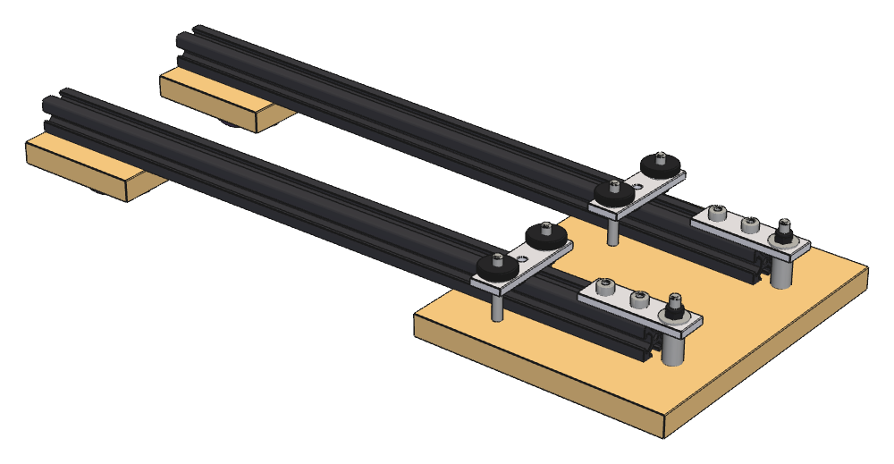
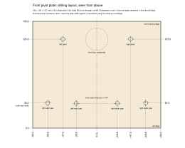

## 4. Tabletop optical frame

The tabletop frame provides a portable, adjustable base to support the optical head fixtures. It is a weight-
and budget-conscious alternative to an optical bench or breadboard.  The model is
`src/schlieren/parts/frame.py`.

  
   
  <em>Fig. 1. Tabletop frame: rails, front pivot plate with pivots and yaw clamps, and rear support
      blocks</em>

### 4.1 Rails

- IXGNIJ black-anodized metric 2020 extrusion, Amazon B08Y8N7FD1
- 20 × 20 × 400 mm
- two rails used
- nominal 6 mm European-style slot

Ordinary attachments use M5 × 0.8 socket-head hardware with flat washers in standard metric lengths and
roll-in/drop-in M5 T-nuts (Amazon B0DP6JBX4Y).

Sighting toward the mirror, the source rail is on the left (negative x in the pivot frame) and the imaging
rail is on the right. This is dictated by fact that the iPhone extends well to the right of its camera axis
when sighting along that axis toward the mirror ([§9.1](09-camera-telephoto.md#91-camera)); placing that
overhang toward the outside of the optical head keeps the phone clear of the source rail and its fixtures.

### 4.2 Front pivot plate

The front pivot plate is a 180 × 150 mm Baltic-birch rectangle with no structural cutouts. The 180 mm
dimension is transverse to the rails and the 150 mm dimension is fore/aft.

Plate coordinates are the pivot frame ([§3.4](01-context-and-layout.md#34-common-optical-axis-datum)): the
origin is at the midpoint of the aft edge, +y runs toward the mirror along the plate centerline, and +x runs
to the right seen from above with the mirror ahead. The mirror-facing edge is at y = 150 mm, and the left rail
is the one at negative x. The pivot line is 25 mm behind the mirror-facing edge, giving pivot centers at:

- left pivot: (-47.50, 125.00) mm;
- right pivot: (+47.50, 125.00) mm;
- total pivot separation: 95 mm.

Each yaw-clamp station is 90 mm aft of its pivot along the nominal rail axis, giving yaw-strap centers at
approximately:

- left strap center: (-48.84, 35.01) mm;
- right strap center: (+48.84, 35.01) mm.

The nominal rail half-angle is about 0.85° ([§3.3](01-context-and-layout.md#33-sourceimager-offset)), and
each of the fixed yaw clamp straps is perpendicular to its rail at that nominal angle. This puts the clamp
bolt locations (at the two outer holes of each 3-hole joining plate) at approximately:

- left outer: (-68.83, 35.31) mm;
- left inner: (-28.84, 34.71) mm;
- right inner: (+28.84, 34.71) mm;
- right outer: (+68.83, 35.31) mm.

  
   
  <em>Fig. 2. Drilling template for the front pivot plate, in plate coordinates</em>

With 40 mm bolt spacing and 90 mm pivot-to-clamp distance, the rails have approximately 7.5 mm nominal
clearance per side to the yaw bolts, and retain about 2.8 mm of this clearance when yawed ±3° from nominal.

A front Sorbothane support foot is attached below the plate, centered at approximately (0, 125) mm, directly
between the two rail pivots.  This keeps the support point on the pivot line and is clear of the pivot and yaw
hardware.

1/2 in Baltic-birch plywood sheet stock is shared across the tabletop frame and mirror cell: it supplies the
front pivot plate, the two rear rail-support blocks, the mirror-cell stationary plate, and the mirror-cell
base plate.

### 4.3 Pivot and yaw hardware

Pivot and yaw hardware use commercially available 2020 three-hole joining plates:

- MOPFOL 2020 3-hole joining plate, Amazon B0G8DCS7VP
- approximately 60 × 18 × 4 mm
- 20 mm hole pitch
- four in all: two as pivot lugs and two as yaw clamp straps.

#### Pivot stack

Per rail, from the bottom up:

socket head → oversized washer → plywood pivot plate → 20 mm spacer → 4 mm joining plate → oversized washer →
M5 nyloc

The socket heads are beneath the plywood and the nylocs on top, matching the yaw clamp bolts. The pivot bolts
pass through 5.5 mm clearance holes in the plywood. The 20 mm spacer holds the pivot lug at the rail top,
where the lug lies along the rail with the pivot bolt through its front hole; its other two holes fix it to
the rail by M5 × 8 socket-head screws from the general M5 assortment into T-nuts in the rail top slot.

Hardware:

- McMaster 92290A265, M5 × 50 partially threaded 316 SS socket-head screw
- McMaster 92871A091, 20 mm × 10 mm OD × 5.3 mm ID stainless spacer
- McMaster 91116A350, M5 oversized washer, 15 mm OD
- McMaster 93625A225, M5 nylon-insert locknut

#### Yaw clamps

One 3-hole joining plate spans transversely across each rail as its yaw clamp strap. Its two outer holes take
the yaw bolts, one on each side of the rail; the rail rotates beneath the strap.

A strip of McMaster 9852N37 adhesive-backed 1/32 in (0.79 mm) EPDM is applied to underside of each strap and
provides friction where the clamp strap bears against the rail top. The strip spans the strap width and stays
between the outer bolt holes (about 30 mm long).

Each yaw bolt stack, from the bottom up:

socket head → oversized washer → plywood pivot plate → (alongside the rail) → EPDM friction strip → 4 mm yaw
strap → oversized washer → M5 thumb nut

The yaw bolts pass up alongside the 20 mm rail, and span the approximately 1/2 in (12.7 mm) Baltic-birch pivot
plate, the full 20 mm rail height, the EPDM friction strip, the 4 mm yaw strap, washers, and the thumb-nut
engagement.  Yaw is adjusted and locked at the front pivot plate by loosening the two thumb nuts, rotating the
rail beneath the strap, and retightening.

Hardware:

- McMaster 92290A265, M5 × 50 partially threaded 316 SS socket-head screws — same part as the pivot bolts
- McMaster 91116A350, oversized M5 washers
- McMaster 92815A202, M5 low-profile knurled thumb nuts
- McMaster 9852N37, 1/32 in EPDM friction strips, cut from the same sheet as the cassette clamp-bar pads

### 4.4 Rear supports and feet

Each rail has a removable 75 × 50 mm Baltic-birch rear rail-support block. The 75 mm dimension runs along the
rail and the 20 mm rail is centered across the 50 mm block width.

Each block attaches to the rail bottom slot with two M5 socket-head screws into roll-in/drop-in M5 T-nuts. The
two screw holes lie on the rail centerline and are 50 mm apart, symmetrically placed about the block center;
with the 75 mm block length, each screw center is 12.5 mm from its nearest end.

Each block's screw stack, from the bottom up:

socket head → two flat washers → plywood rail-support block → M5 T-nut in the rail bottom slot

The doubled washers provide some margin for a standard 20 mm screw to avoid bottoming out against the rail
slot floor in the face of minor plywood thickness and rail manufacturing variations.

A Sorbothane foot is centered on the underside of each block, directly beneath the rail centerline and midway
between the two attachment screws.  The complete frame is therefore supported on the table/bench top at three
points:

- one centered foot beneath the front pivot plate;
- one foot beneath each rear rail-support block.

Feet: McMaster 8215K2, 1-1/4 in OD × 5/8 in high, 30 OO Sorbothane, with a stiffer McMaster 8215K6 (same size)
as an alternative depending on vibration isolation needs. Moderate static compression of the feet is
acceptable; the resulting small pitch and roll effects can be corrected with fine mirror alignment.