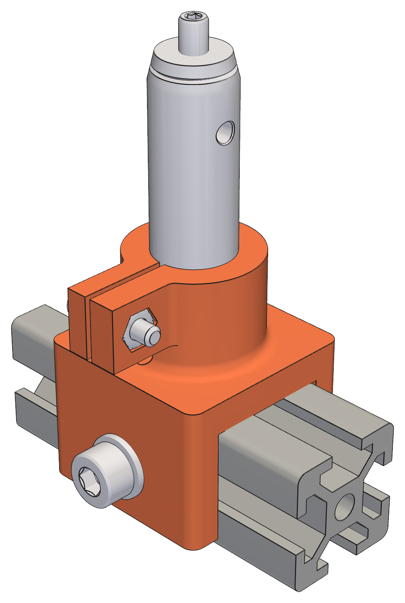

## 5. Common rail-mounted post support

The common post support establishes fixtures accurately at the optical axis, and bridges between the
commercial optomechanical and 2020 rail ecosystems. The model is `src/schlieren/parts/rail_shoe.py`.

  
   
  <em>Fig. 3. Common rail shoe on rail with TR50/M post</em>

### 5.1 Post and shim

The chosen optical post is the Thorlabs TR50/M.  These are 303 stainless steel, 12.7 mm diameter, 50 mm long
with an M4 setscrew at the top which accommodates various Thorlabs SM1 metric fixed mounts.

Each post rests on a stainless steel shim disk, which provides a consistent metal seating surface across the
central slot in the 2020 rail.  The shims are McMaster 2895T62, 3/4 in OD discs × 0.010 in ±0.0005 in thick,
full-hard 18-8 stainless steel.

### 5.2 Rail shoe

The shoe is a printed PLA U-shaped saddle that:

- straddles the 2020 extrusion;
- locks with M5 hardware into T-nuts in the rail side channels;
- leaves the rail top available as the datum surface;
- carries a vertical 12.7 mm through-bore for the TR50/M post.

The post passes through the printed shoe and bottoms on a stainless datum shim resting on the rail top,
so the optomechanics, and not the printed PLA, establish the precision optical height.

The post bore incorporates a single-split clamping collar so that the post can be locked against rotational
movement while remaining fully seated on the metal datum.  Ear thickness and the approximately 1–2 mm relaxed
split gap are designed around the clamping setup:

M3 socket-head screw → clearance through one ear → captured M3 hex nut in the opposite ear

Hardware:

- McMaster 91292A114, M3 × 12 fully threaded 18-8 SS socket-head screw
- McMaster 91828A211, M3 18-8 SS hex nut

### 5.3 Post-top mounts

Three fixtures use the common post/shoe architecture:

1. light source ([§6](06-light-source.md#6-light-source));
2. source-slit flexure head ([§7](07-source-slit.md#7-source-slit));
3. cutoff carriage ([§8](08-cutoff.md#8-cutoff)).

The light source uses a Thorlabs SMR1/M internally threaded lens mount, and the source-slit and cutoff
assemblies seat in Thorlabs SM1RC/M lens tube split slip rings. These mounts preserve a 22.1 mm post-top to
optical-axis dimension.
