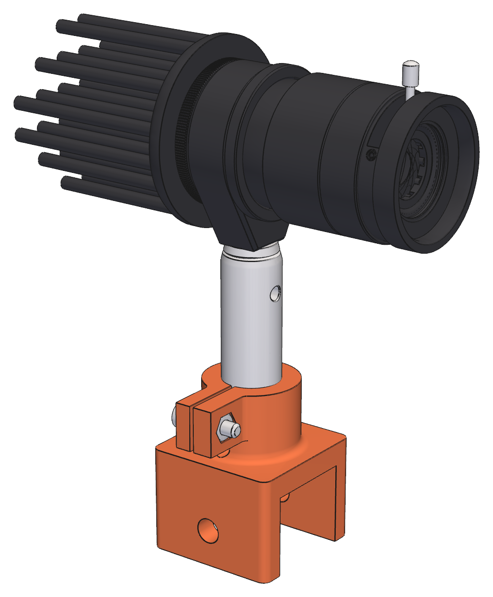
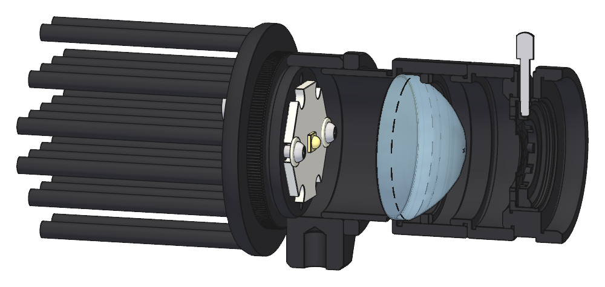
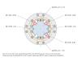
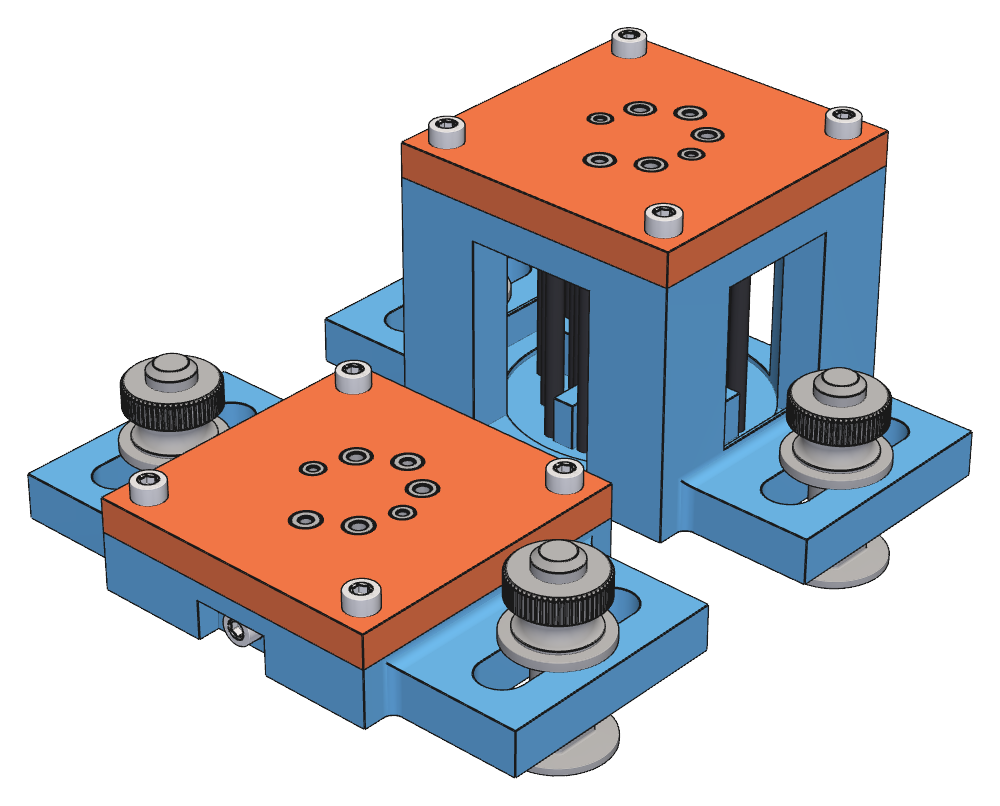

## 6. Light source

The light source is a single assembly on one post and common rail shoe
([§5](05-post-support.md#5-common-rail-mounted-post-support)). A threaded holder carries one of two
interchangeable threaded LED modules on its rear face, and a condensing lens and iris on its forward face. The
condenser images the LED emitter onto the source slit ([§7](07-source-slit.md#7-source-slit)), and the iris
sets the angular size of the illumination cone ([§3.2](01-context-and-layout.md#32-source-cone)).

`src/schlieren/parts/light_source.py` models the stack-up; `uv run light-source` prints the focus ranges.

### 6.1 Assembly and stack order

From the LED to the slit:

1. threaded LED module ([§6.2](#62-led-modules)), with Thorlabs SM1CP2M cap threaded into the LED-side face of
   the SMR1/M;
2. Thorlabs SMR1/M mount (accepts the post);
3. Thorlabs SM1V05, with its externally threaded sleeve entering the slit-side face of the SMR1/M and locked
   with the included SM1NT locking ring. A Thorlabs ACL2520U-A condensing lens sits in the SM1V05 body with
   its plano face on the internal seat (toward the LED) and its convex face toward the open end;
4. Thorlabs SM1L03 spacer ring, threaded into the SM1V05 open end;
5. Thorlabs SM1D12 adjustable iris, threaded into the SM1L03.

  
   
  <em>Fig. 4. Light source on its post and rail shoe: heatsink and LED module, SMR1/M, SM1V05, SM1L03, and
  iris</em>

  
   
  <em>Fig. 5. Light-source cutaway, showing internal position of LED module and condensing lens</em>

The ACL2520U-A convex vertex sits about 0.7 mm inside the SM1V05 open end, so the SM1L03 spacer is required
ahead of the iris; the SM1D12 interferes with the lens if threaded directly into the SM1V05.

The cap and the SM1V05 sleeve share the SMR1/M thread. The cap threads in until its knurled flange seats on
the SMR1/M face, so the LED position is fixed, and the SM1V05 engagement is the focus adjustment
([§6.7](#67-focus-and-module-interchange)). Engagement runs from the Thorlabs minimum of 0.110 in / 2.79 mm to
about 5.7–5.8 mm, where the sleeve end comes within 0.3 mm of the LED board. Turning the SM1V05 moves the lens
and iris together relative to the LED; the resulting few-millimeter iris shift is negligible against the 150
mm iris-to-slit spacing.

### 6.2 LED modules

There are two interchangeable LED modules, each a self-contained threaded assembly. The LEDs chosen are on
industry-standard 20 mm "star" MCPCB carriers. Each carrier is mounted on an identical threaded SM1
cap, so the SM1 thread and cap flange are the interchange standard.

| Module | Emitter                             | Board                                    | Initial operating current (mA) |
| ------ | ----------------------------------- | ---------------------------------------- | ------------------------------ |
| Green  | OSRAM OSLON SSL 120, 530 nm nominal | NewEnergy star board, LST1-01F06-GRN1-00 | ~350                           |
| White  | Nichia 519A R9080, 5000 K           | Convoy 20 mm star/DTP carrier            | ~500–700                       |

Module stack, from the rear toward the condenser:

1. Alpha CN40-40B heatsink ([§6.3](#63-common-heatsink)), bolted to the rear face of the cap with thermal
   compound between;
2. Thorlabs SM1CP2M externally SM1-threaded end cap (0.210 in / 5.33 mm solid aluminum, 0.100 in / 2.54 mm
   thread, Ø1.200 in / 30.48 mm knurled flange);
3. LED star board on the front face of the cap ([§6.4](#64-led-board-mounting)).

Interfaces:

- The cap flange is the repeatable axial stop on the SMR1/M face; the module's rotational position at the stop
  does not matter.
- The SM1 thread centers the emitter on the condenser axis; no vertical calibration is required.
- Heatsink fastening: three M3 × 6 mm socket-head screws through the CN40 base, their heads in open cells
  between four pins, into M3 holes tapped through the cap. Positions are in [§6.4](#64-led-board-mounting).
  **Provisional:** the screw length.
- Leads drop past the star board's flat edges through two Ø2.0 mm holes in the cap and the heatsink base, 11.0
  mm from the axis (inside the thread relief), and out between the pin columns. The pigtail wire measures
  about 1.7 mm over its insulation.
- Fabrication is drilling and tapping of purchased aluminum parts only ([§6.4](#64-led-board-mounting)), drilled
  through the printed fixture of [§6.8](#68-cap-and-heatsink-drilling-fixture).

Clearances:

- The heatsink's lowest point is 2.1 mm above the TR50/M post top at any rotation (22.1 mm axis offset minus
  20 mm maximum radius).
- The heatsink front face is 2.79 mm (0.110 in) behind the SMR1/M face (the cap flange thickness).
- The SMR1/M thread bore leaves about 3 mm of radial room around a 20 mm board for leads.

### 6.3 Common heatsink

- Alpha CN40-40B natural-convection pin-fin heatsink, one per module
- Ø40.0 mm (+0/−0.5) × 40 mm overall, 3.0 mm flat base, Ø2.8 mm pins on a 6.9 mm square grid
- 6063 aluminum, black anodized; 24.6 g
- manufacturer natural-convection rating 6.9 °C/W

At about 2 W (white module at 700 mA) the expected rise is roughly 14 °C above ambient; the green module
dissipates about 1.1 W. The rating is the manufacturer's pins-up test; the module runs with pins horizontal,
which pin fins tolerate well. **Provisional:** bench-test the temperature rise at 700 mA before relying on it.

The heatsink is round, with a radius under the 22.1 mm axis offset, so that it clears the post top at every
rotation while the module is threaded in ([§6.2](#62-led-modules)).

### 6.4 LED board mounting

Measured star-board thicknesses (calipers):

- green NewEnergy star: 0.0625 in / 1.59 mm (the datasheet lists 0.047 or 0.067 in; the measured value
  governs)
- white Convoy 20 mm star: 0.0590 in / 1.50 mm

Both boards are about 20 mm across (NewEnergy 0.783 in / 19.9 mm, catalog).

Fastening standard:

- M2 × 0.4
- McMaster 92095A453, M2 × 6 mm screws
- tapped directly into the front (threaded) face of the SM1CP2M cap, in through holes
- 1.6 mm tap drill
- M2 × 0.4 HSS plug tap

Use the cap's center-drill mark as the layout datum for the board hole pattern. Transfer each carrier board's
hole geometry from the physical board rather than assuming it from the other module. Slightly oversized board
holes permit final centering of the emitter on the cap axis: a 0.3 mm emitter offset moves the emitter image
on the slit about 2 mm, so center each board by watching its image on the slit blades before final tightening.

A thin insulating washer goes under each screw head, keeping the metal head off exposed board contacts and
spreading its clamp over the board beside the notch:

- McMaster 91545A410
- M2 lubricant-filled nylon flat washer

A thin layer of thermal compound is used between board and cap.

#### Cap and heatsink hole layout

All holes in the cap and in the heatsink base are **through holes**, drilled from one face. Plain plug taps
(M3 × 0.5, M2 × 0.4) cut full threads through them; no bottoming tap is required. No screw reaches the far
face of the cap: the M2 screws are 6 mm under the head, about 4 mm of it in the cap past the board and washer,
and the M3 screws engage about 3 mm past the 3.0 mm heatsink base.

  
   
  <em>Fig. 6. Cap and heatsink hole layout, seen from the LED side, in the frame of the heatsink pin
    lattice</em>

Coordinates are in millimeters from the optical axis, +x to the right and +y up as seen from the LED side, in
the frame of the pin lattice; the cap and the heatsink are drilled to the same coordinates:

| Hole      | Position                                       | In the cap               | In the heatsink base |
| --------- | ---------------------------------------------- | ------------------------ | -------------------- |
| M3, three | (+6.90, +6.90), (−6.90, +6.90), (+6.90, −6.90) | Ø2.5 tap drill, M3 × 0.5 | Ø3.3 clearance       |
| M2, two   | (±9.30, 0)                                     | Ø1.6 tap drill, M2 × 0.4 | none                 |
| Lead, two | (0, ±11.0)                                     | Ø2.0                     | Ø2.0                 |

- M3 holes: each is the center of a cell of the pin lattice, 4.88 mm from each of four pins, so the Ø5.5 mm
  socket head lands between the pins with 0.73 mm to spare and the key reaches it. Three screws hold the
  heatsink without a rocking axis; the fourth cell is free but unused. Roughly 70% of each hole's area lies
  under the star, a small loss of its thermal contact.
- M2 holes: in the two opposite corner notches of the star on the x axis, 0.225 mm inboard of the center of the
  notch's 1/8 in arc (0.375 in from the axis). Each notch is that arc flaring to a mouth 0.138 in wide on the
  NewEnergy star and at most 0.150 in on the Convoy. Measured across opposite notches, the closed ends are at
  r = 7.98 mm (NewEnergy) and 7.93 mm (Convoy), so the Ø2 shank keeps at least 0.32 mm of play in x for
  centering the emitter. Moving in puts the head's edge 0.4 mm onto the notch's closed end, and the washer's
  outer edge at r = 11.8 mm, 0.75 mm from the cap's thread relief. The holes are covered by the solid
  heatsink base, so they do not meet the pins.
- Lead holes: on the axis through the midpoints of two opposite flat edges of the star, centered at 11.0 mm
  radius and tangent to each edge. Each is 1.1 mm from the nearest pins, in the 4.1 mm channel between pin
  columns.
- The smallest wall between holes in the cap, measured to the thread major radius, is 4.9 mm. The lead holes'
  outer edges, at 12.0 mm radius, leave about 0.55 mm to the cap's thread relief, the straight shank
  beneath the threads, which measures Ø0.988 in (12.55 mm radius) and is the boss's minimum radius.

Full-scale drilling templates for both parts, to print at 100% on white Avery 5263 laser labels (first row)
and stick on, come from `uv run light-source --templates`: the cap template goes on the LED-side face with its
crosshair on the center-drill mark, and the heatsink template on the flat base face, aligned to the pin rows.
Both are viewed from the LED side, so they share one set of coordinates.

### 6.5 Power and wiring

Power supply:

- ALIENTEK DP100
- use DC constant-current operation rather than PWM to avoid rolling-shutter banding

Connector standard:

- Micro-Fit 3.0
- 2-pin
- 18 AWG factory pigtails

Connector hardware:

- 2 × Molex 214758-1021, male-to-pigtail, 150 mm — module side
- 1 × Molex 214756-1023, female-to-pigtail, 600 mm — supply side
- 1 × Pomona 1825-02 red/black 4 mm banana-plug pair

The supply side should present recessed/socket contacts.

### 6.6 Condenser optics

The condenser images the LED emitter onto the source slit (about 6.6× magnification). Each slit point receives
light from its conjugate emitter point through the full iris aperture, so its cone is uniformly filled in angle
and every slit point illuminates the whole mirror uniformly. Emitter structure appears as intensity variation
along the slit, not as structure in the mirror illumination. The LED image should cover the illuminated slit
length; the domes enlarge the apparent emitters by about 1.4–1.5×.

Defocus in either direction underfills the ±1.82° cone: iris-edge rays then trace back beyond the emitter
edge, darkening the mirror edge and shortening the uniformly lit slit length. With the LED at the condenser
focus (12 mm, collimated) the emitter cannot fill the cone even at the slit center.

Using ACL2520U-A catalog values (EFL 20.1 mm, BFL 12.0 mm; object-side principal plane about 8.1 mm inside the
plano face) and about 153 mm from the convex vertex to the slit, the optimum emitter-to-plano-face gap is
about 15 mm. The optimum moves only about ±0.7 mm for ±30 mm of slit position.

### 6.7 Focus and module interchange

Setup values (not hard CAD dimensions):

- emitter-to-plano-face gap approximately 15 mm, measured to the emitting surface, not the dome top
- useful gap range roughly 13–17 mm
- condenser/iris-to-slit spacing approximately 150 mm
- initial iris opening approximately 9–10.5 mm (about ±1.7–2.0° at 150 mm)

Set focus by imaging the LED onto the closed slit blades and turning the SM1V05 until the emitter image is
sharp and centered, then lock the SM1NT and open the slit.

Calculated emitter heights above the cap face, using the measured board thicknesses, about 0.07 mm of solder,
and the apparent emitter heights through the LED domes (calculated from the manufacturer outline drawings:
OSLON about 0.45 mm, 519A about 0.75 mm), with the gap range each module reaches over the SM1V05 engagement
range:

| Module | Emitter height above cap face | Emitter-to-plano gap range | SM1V05 engagement at 15 mm gap |
| ------ | ----------------------------- | -------------------------- | ------------------------------ |
| Green  | about 2.1 mm                  | about 13.2–16.2 mm         | about 3.9 mm                   |
| White  | about 2.3 mm                  | about 12.9–16.0 mm         | about 3.7 mm                   |

The two modules focus about 0.2 mm apart in engagement, about one-third of a turn of the SM1 thread. An index
mark per module on the SM1V05 is optional.

Focus margin about the 15.04 mm optimum gap is about 1.1 mm (long-gap side) and 1.8 mm (short-gap side) for
the green module, and only about 0.93 mm and 2.1 mm for the white module. The white module's long-gap travel
is limited by the SM1V05 minimum engagement. **Provisional:** the white module's reduced margin is to be
confirmed on the build. If it cannot reach a sharp emitter image on the slit, space its cap flange off the
SMR1/M face with a thin shim; about 0.1 mm brings the long-gap margin to about 1.0 mm. The shim moves the
whole module away from the lens and keeps the flange as the axial stop; a shim under the star board would
instead shorten the gap and make the shortfall worse.

Module interchange:

1. disconnect the Micro-Fit lead;
2. unscrew the module (cap and heatsink together) from the SMR1/M, about four turns;
3. screw in the alternate module until its flange seats;
4. touch up focus on the closed slit blades if needed.

In transport, the condenser/iris assembly is protected from dust and scratches by a Thorlabs SM1CP1 internally
threaded end cap and an SM1EC2 snap-on dust cap.

### 6.8 Cap and heatsink drilling fixture

The §6.4 hole layout is drilled through a fixture of three printed parts and seven press-fit steel drill
bushings, so the hole positions come from the fixture and not from how a drill press is set up by eye. Two
requirements set the accuracy needed, about 0.1 mm on position:

- The 2.0 mm lead holes in the cap and the heatsink base must line up through the bolted joint, for a pigtail
  wire about 1.7 mm over its insulation.
- A 0.3 mm emitter offset moves the emitter image about 2 mm on the slit ([§6.4](#64-led-board-mounting)), so
  the M2 board holes must not shift the star far from the axis.

  
   
  <em>Fig. 7. Drilling fixture: bushing plate on the cap nest (left) and on the heatsink nest (right)</em>

`src/schlieren/parts/led_drill_fixture.py` models the fixture; `uv run led-drill-fixture` exports the STEP and STL
files and the figure.

#### Parts

One **bushing plate** serves both parts, so the leads, and the M3 holes that fix the cap-to-heatsink rotation,
are drilled from the same coordinates. A **cap nest** and a **heatsink nest** each locate one part under it.
All are printed in PLA.

Bushings, McMaster metric press-fit drill bushings (hardened steel, 6 mm long, chamfered on one end); each
bore is the drill that makes the cap's hole ([§6.4](#64-led-board-mounting)):

| Hole           | Count | Bore (mm) | Outside diameter (mm) | SKU       |
| -------------- | ----- | --------- | --------------------- | --------- |
| M2 tap drill   | 2     | 1.6       | 4                     | 96990A132 |
| M3 tap drill   | 3     | 2.5       | 5                     | 96990A147 |
| Lead hole      | 2     | 2.0       | 5                     | 96990A139 |

- The plate is 54 mm square and 6 mm thick, the bushing length, so the bushings sit flush on both faces. Its
  bores are at the layout coordinates, in the frame seen looking down at the part's LED-side face (+x right,
  +y up). The smallest web between bores is 2.8 mm.
- Under the plate, a registration ring (Ø45.0 mm outside, Ø41.0 mm inside, 2.5 mm high) fits the Ø45.2 mm bore
  in the top of either nest, with a key tab on +x that fits a slot in the nest. The tab allows one orientation
  only. The plate seats on the nest's top face and is held by four M3 × 12 mm screws, through its corner
  clearance holes into M3 heat-set inserts in the nest's corners. The inserts are McMaster 97171A310 brass
  flanged inserts (5.7 mm installed length, Ø5.5 mm flange 0.53 mm thick), set in Ø4.0 mm holes with the
  flange recessed flush with the nest's top face. The socket heads stand 3 mm above the plate's top face, 31
  mm from the axis; the plate has no counterbores.
- The nests share the 54 mm square outline and the plate bore. The plate's bushing ends stand 2.0 mm off the
  part's LED-side face, which leaves room for chips.
- A Ø10 mm boss, 1.5 mm tall, under the center of the plate carries a Ø10 mm disc of the 1/32 in
  adhesive-backed EPDM sheet (McMaster 9852N37; the sheet is in the cassette allocation). Seated, the disc
  presses on the part's face with about 0.3 mm of compression. It holds the cap on its support ring and the
  heatsink on its pin tips against the bit grabbing, and is 2.3 mm clear of the nearest bushing.
- The plate is printed ring-up, so the bores are vertical.

Cap nest:

- A Ø30.68 mm pocket (0.20 mm diametral clearance on the Ø30.48 mm flange) holds the cap boss-up. The flange
  back face stands on a support ring around a Ø25 mm relief window through the floor; the holes reach 12.0 mm
  from the axis, so the exits and chips clear the support.
- An M3 clamp screw, in a heat-set insert on the −y side at the flange mid-thickness, pushes the cap against
  the opposite wall of the pocket and keeps it from turning if the drill grabs. A notch in the −y face thins
  the wall there to 7.7 mm, so the 12 mm screw protrudes about 4 mm into the pocket.

Heatsink nest:

- The heatsink stands pins down, on the floor, and is drilled from its flat base face. A cross-shaped rib 3.8
  mm wide and 8 mm tall stands in the two open channels through the center of the pin lattice, which are 4.1
  mm wide, 0.15 mm of clearance each side. The rib fixes the position and rotation in the lattice frame, the
  frame the layout is defined in; the Ø40 mm base diameter has a +0/−0.5 mm tolerance and is not used.
- The plate seats 2.0 mm above the 40 mm height of the heatsink. The lead and M3 drills exit well above the
  rib. Four side windows show the pins and the rib.

#### Mounting on the drill press

The nests mount on the base of a Dremel 220 drill press, which has four diagonal slots, 3/8 in wide and 7/32
in deep, running from 3/4 in (the apex of the slot's inner rounded end) to 2-1/4 in (the keyhole) from the
spindle axis. Each nest has two ears, 8 mm thick, on its ±x faces, and sits turned 45° on the base so that its
x axis lies along one diagonal pair of base slots. A 2 mm fillet where each ear meets the face, along its top
edge and its ends and blended at the corners, spreads the clamping load at the root.

- A 5/16-18 × 1-1/4 in square-neck carriage bolt (McMaster 92356A589) rides in each base slot, head under the
  base and its 0.32 in square neck in the slot, which keeps it from turning. It goes in from the top, the head
  tipped through the slot's 5/8 in keyhole, or from underneath.
- The bolt passes through a slot in the ear that runs along the face (y), 40 mm from the axis, and a 5/16 in
  SAE washer and a flanged knurled thumb nut (McMaster 95150A180, 5/8 in head) clamp the ear from the top. The
  thumb nut clears the nest face by 5 mm.
- The fixture moves in x along the base slots (±10.5 mm) and in y along the ear slots (±12 mm), enough to
  bring any bushing under the spindle. Over that travel the bolt neck stays between 25 and 55 mm from the
  spindle axis, inside the slot.
- A 1/8 in UHMW sheet under the nest, with clearance slots for the bolts, protects the base where the bits
  exit away from its center hole. The bolt length allows for it.

To move between holes, loosen the thumb nuts, lower the bit into the next bushing and hold it there, and tighten
the thumb nuts; the bushing sets the fixture's position.

#### Drilling

Both parts are drilled through the plate from the LED-side face.

- Cap: all seven holes, through. Then tap the M3 and M2 holes by hand ([§6.4](#64-led-board-mounting)).
- Heatsink: the three M3 positions with the 2.5 mm bushings as pilots, then opened to the Ø3.3 clearance with
  the larger bit following the pilot; and the two lead holes. The plate carries all seven bushings for both
  parts, but the M2 positions are not drilled in the heatsink.

Because one plate drills both parts, an error in the plate's bore positions shifts the holes in both parts the
same way, which keeps the two sets of lead holes in line.

**Provisional:**

- The printed bore size for the bushings. The plate bores are designed at the bushing outside diameter, which
  printed holes of this size are likely to undercut, and the bushings are pressed in; print the bore coupon
  (`led_drill_bore_coupon`, bores drawn 0.00 to 0.20 mm over the outside diameter in 0.05 mm steps, for both
  outside diameters) to find the bore that gives a press fit, and set the bore oversize.
- The positional accuracy of the printed plate. The assumed 0.1 mm is to be checked by measuring the holes
  drilled in the first cap against the layout.
- The fit of the heatsink rib in the pin channels, and the height of the heatsink setup on the drill press.
