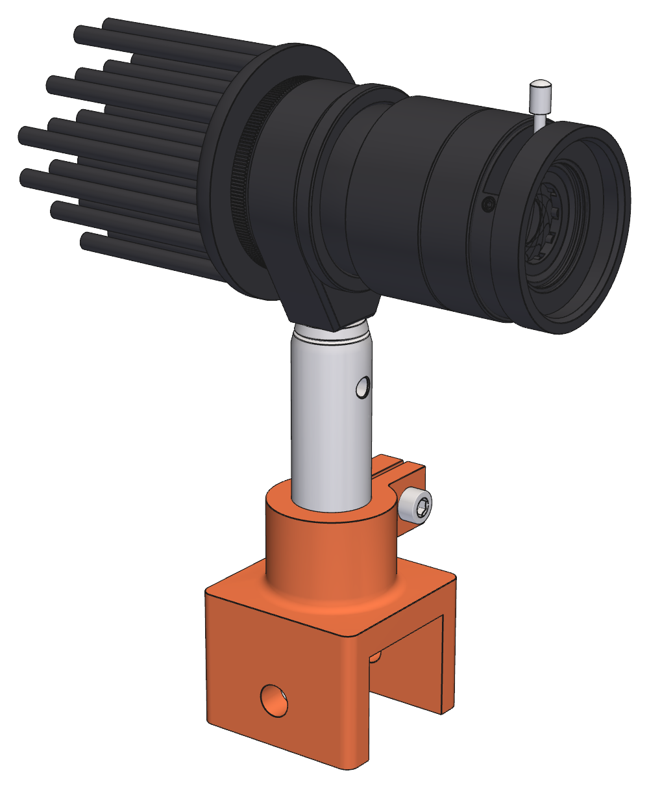
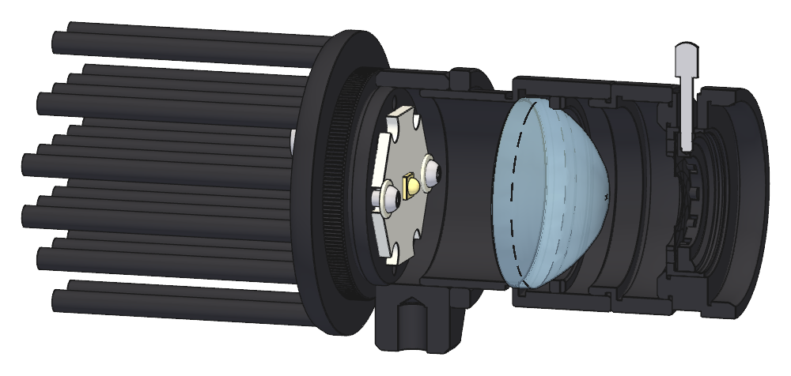
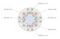
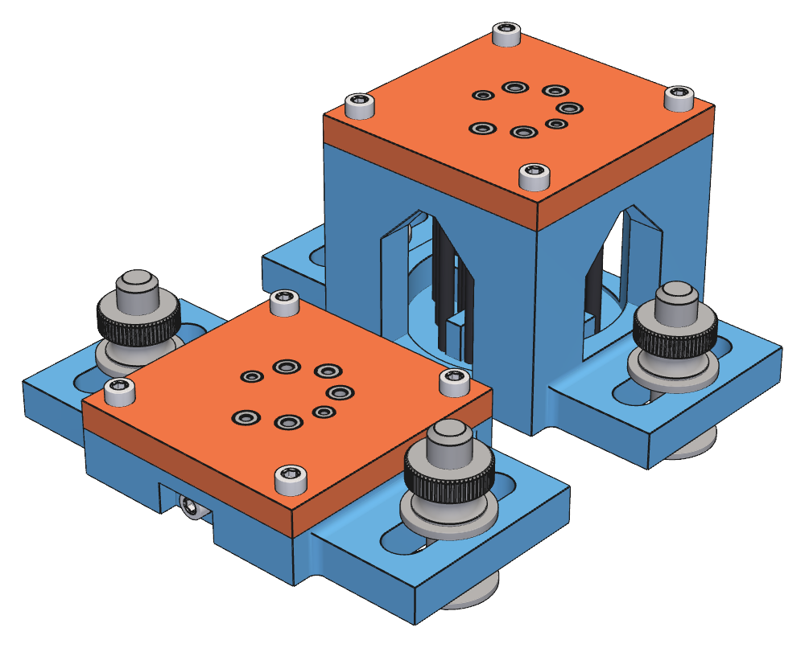

## 6. Light source

The light source is a single assembly utilizing the common post support
([§5](05-post-support.md#5-rail-mounted-posts)). An internally threaded mount carries an interchangeable LED
module on its rear face, and a condensing lens and iris on its forward face. The condenser images the LED
emitter onto the source slit ([§7](07-source-slit.md#7-source-slit)) ahead, and the iris sets the angular size
of the illumination cone. The model is `src/schlieren/parts/light_source.py`.

  
   
  <em>Fig. 4. Light source on its post and rail shoe</em>

### 6.1 Assembly and stack order

From the LED toward the slit:

1. LED module;
2. Thorlabs SMR1/M mount;
3. Thorlabs SM1V05 adjustable lens tube;
4. Thorlabs ACL2520U-A condensing lens seated in the lens tube;
5. Thorlabs SM1L03 spacer ring, to provide relief between the lens vertex and the iris ahead;
6. Thorlabs SM1D12 adjustable iris.

  
   
  <em>Fig. 5. Light-source cutaway, showing internal position of LED carrier and condensing lens</em>

The LED modules and the condenser lens holder share opposite sides of the SMR1/M mount thread. The module
threads in until seated against the rear SMR1/M face, providing reapeatable LED positioning, and the remaining
forward thread is used by the lens holder for focus adjustment.

### 6.2 LED modules

The LED modules are constructed around Thorlabs SM1CP2M SM1 externally threaded solid aluminum end caps.
Each cap is drilled and tapped so a heatsink can be screwed to its rear face, and an LED carrier board screwed
to its front face.  The cap's external SM1 thread then serves as the module interchange standard, supporting
and aligning the module in the assembled light source.

#### Heatsink

- Alpha CN40-40B natural-convection pin-fin heatsink, one per module
- 6063 aluminum, black anodized; 24.6 g
- Ø40.0 mm × 40 mm overall, 3.0 mm flat base, Ø2.8 mm pins on a 6.9 mm square grid
- manufacturer natural-convection rating 6.9 °C/W

The above rating is the manufacturer's pins-up test; the module runs with pins horizontal, which pin fins
tolerate well.

The heatsink and cap are fastened with three M3 × 6 mm socket-head screws run through drilled clearance holes
in the heatsink base into corresponding tapped M3 holes in the cap. The screws are positioned so their heads
sit on the heatsink base in open cells between sets of four pins. Three such screws hold the heatsink without
a rocking axis; the fourth cell is free but unused.  A thin layer of thermal compound is used between the
heatsink and the cap.

The heatsink base also has drilled holes to accommodate exit of the LED power leads, which are run out between
pin columns.

#### LEDs

The LEDs chosen are on industry-standard 20 mm "star" MCPCB carriers:

| Module | Emitter                             | Board                                    | Initial operating current (mA) |
| ------ | ----------------------------------- | ---------------------------------------- | ------------------------------ |
| Green  | OSRAM OSLON SSL 120, 530 nm nominal | NewEnergy star board, LST1-01F06-GRN1-00 | ~350                           |
| White  | Nichia 519A R9080, 5000 K           | Convoy 20 mm star/DTP carrier            | ~500–700                       |

Each star board is fastened to its module with a pair of M2 x 6mm screws through board slots into tapped
holes on the front of the cap; slightly oversized board slots permit final centering of the emitter on the cap
axis. A thin insulating washer goes under each screw head, keeping the metal head off exposed board contacts
and spreading clamp contact over the board slot. A thin layer of thermal compound is also used between board
and cap.

Leads drop past the star board's flat edges and pass out through two Ø2.0 mm holes in the cap and heatsink
base, positioned inside the cap thread relief.

#### Cap and heatsink hole layout

The drill and tap prescriptions for the cap and heatsink are as follows.  Coordinates are in millimeters from
the optical axis, +x to the right and +y up as seen from the LED side, in the frame of the heatsink pin
lattice:

  
   
  <em>Fig. 6. Cap and heatsink hole layout, seen from the LED side.  Grey: heatsink; orange: cap; blue:
  20 mm star; red: M3 hardware; green: M2 hardware</em>

| Hole      | Position                                       | In the cap               | In the heatsink base |
| --------- | ---------------------------------------------- | ------------------------ | -------------------- |
| M3, three | (+6.90, +6.90), (−6.90, +6.90), (+6.90, −6.90) | Ø2.5 tap drill, M3 × 0.5 | Ø3.3 clearance       |
| M2, two   | (±9.30, 0)                                     | Ø1.6 tap drill, M2 × 0.4 | none                 |
| Lead, two | (0, ±11.0)                                     | Ø2.0                     | Ø2.0                 |

All holes in the cap and in the heatsink base are **through holes**, drilled from one face. Plain plug taps
cut full threads through them; no bottoming taps are required. No screw reaches the far face of the cap in
either direction: the M2 screws are 6 mm under the head, about 4 mm of it in the cap from the front past the
board and washer, and the M3 screws engage about 3 mm past the 3.0 mm heatsink base from the back.

#### Drilling fixtures

In practice, the cap and heatsink require fairly precise drilling; the lead holes' outer edges, for example,
leave only about 0.55 mm to the cap's outer thread relief. The Ø2.0 mm lead hole alignment between cap and
heatsink must also be kept pretty tight to avoid impinging the Ø1.7 mm leads passing through both. To this
end, a bushed drill template and custom alignment nests for both the caps and heatsink were designed. The
model for these is `src/schlieren/parts/led_drill_fixture.py`.

  
   
  <em>Fig. 7. Drilling fixtures: bushing plate on the cap nest (left) and on the heatsink nest (right)</em>

A single **bushing plate** serves both parts, so the lead exit holes and the M3 holes that fix the
cap-to-heatsink rotation are drilled from the same coordinates. A matching **cap nest** and a **heatsink
nest** each locate one type of part beneath. All are printed in PLA, with a keyed registration between cap and
nests allowing only a single assembled orientation for each.

Selected hardened steel metric press-fit drill bushings for the plate are as follows:

| Hole           | Count | Bore (mm) | Outside diameter (mm) | SKU                |
| -------------- | ----- | --------- | --------------------- | ------------------ |
| M2 tap drill   | 2     | 1.6       | 4                     | McMaster 96990A132 |
| M3 tap drill   | 3     | 2.5       | 5                     | McMaster 96990A147 |
| Lead hole      | 2     | 2.0       | 5                     | McMaster 96990A139 |

The bushing plate bores are drawn over the bushing outside diameter to allow for printed hole undercutting.
They give a press fit, found with the bore coupon (`led_drill_bore_coupon`, 0.00 to 0.20 mm over in 0.05 mm
steps). A little low-viscosity cyanoacrylate, wicked in around each bushing, retains it.

The bushing plate seats on each nest's top face, and is held there during drilling by four M3 × 12 mm screws
through corner clearance holes in the bushing plate into brass flanged heat-set inserts in each nest's
corners. The nests are designed to leave a 2.0 mm gap between the bottom of the plate and the top of the
drilled surface to accommodate drill chips. A boss under the center of the bushing plate carries a disc of the
1/32 in adhesive-backed EPDM sheet (McMaster 9852N37; the same sheet used elsewhere). Seated, that disc
presses down on the drilled part's top face with about 0.3 mm of compression to help restrain the part against
wobble or bit grabbing.

The cap nest additionally has an M3 x 12 mm side clamp screw through a heat-set insert which bears against the
knurled edge of the held cap, while the heatsink nest has a cross-shaped rib that engages between the held
heatsink's pins opposite the drilling surface.  Both of these measures restrain the held parts against
rotation within their nests while drilling.

**Mounting on the drill press**

The nests as modeled mount on the base of a Dremel 220 drill press, which has four diagonal keyhole slots.
Each nest inself has two slotted ears, on its ±x faces.  The nests sit turned 45° on the drill press base so
their x axis lies along one pair of base slots.

One carriage bolt on each side extends upward through a drill press base slot, through a nest ear and a flat
washer, and engages a flanged knurled thumb nut at the top of the stack. The fixture can thus be located in x
along the base slots, and in y along the ear slots, enough to bring any bushing under the drill drill spindle.

**Drilling**

Both parts are drilled through the plate from the LED-side face. To move between holes, loosen the thumb
nuts, lower the bit into the next bushing and hold it there, and tighten the thumb nuts; the bushing sets the
fixture's position.

- Cap: all seven holes, through. Then tap the M3 and M2 holes by hand.
- Heatsink: the three M3 positions the two lead holes.  Then open the M3 holes to Ø3.3 clearance with a
  hand drill at low speed.

The plate carries all seven bushings for both parts, but the M2 positions are not drilled in the heatsink.

### 6.5 Power and wiring

Power supply:

- ALIENTEK DP100
- use DC constant-current operation rather than PWM to avoid rolling-shutter banding

Connector standard:

- Micro-Fit 3.0
- 2-pin
- 18 AWG factory pigtails

Connector hardware:

- 2 × Molex 214758-1021, male-to-pigtail, 150 mm — module side
- 1 × Molex 214756-1023, female-to-pigtail, 600 mm — supply side
- 1 × Pomona 1825-02 red/black 4 mm banana-plug pair

The supply side should present recessed/socket contacts.

The white LED dissipates about 2 W at 700 mA, for a steady state temperature rise roughly 14 °C above ambient
taking into consideration the manufacturer heatsink specs above. The green module dissipates about 1.1 W.
**Provisional:** bench-test the temperature rise at 700 mA.

### 6.6 Condenser optics

The condenser images the LED emitter onto the source slit (about 6.6× magnification). Each slit point receives
light from its conjugate emitter point through the full iris aperture, so its cone is uniformly filled in angle
and every slit point illuminates the whole mirror uniformly. Emitter structure appears as intensity variation
along the slit, not as structure in the mirror illumination. The LED image should cover the illuminated slit
length; the domes enlarge the apparent emitters by about 1.4–1.5×.

Defocus in either direction underfills the ±1.82° cone: iris-edge rays then trace back beyond the emitter
edge, darkening the mirror edge and shortening the uniformly lit slit length. With the LED at the condenser
focus (12 mm, collimated) the emitter cannot fill the cone even at the slit center.

Using ACL2520U-A catalog values (EFL 20.1 mm, BFL 12.0 mm; object-side principal plane about 8.1 mm inside the
plano face) and about 153 mm from the convex vertex to the slit, the optimum emitter-to-plano-face gap is
about 15 mm. The optimum moves only about ±0.7 mm for ±30 mm of slit position.

### 6.7 Focus and module interchange

Engagement runs from the Thorlabs minimum of 2.79 mm to about 5.7–5.8 mm, where the sleeve end comes within
0.3 mm of the LED board. Turning the SM1V05 moves the lens and iris together relative to the LED, but the
resulting few-millimeter iris shift is negligible against the 150 mm iris-to-slit spacing.

Setup values (not hard CAD dimensions):

- emitter-to-plano-face gap approximately 15 mm, measured to the emitting surface, not the dome top
- useful gap range roughly 13–17 mm
- condenser/iris-to-slit spacing approximately 150 mm
- initial iris opening approximately 9–10.5 mm (about ±1.7–2.0° at 150 mm)

Set focus by imaging the LED onto the closed slit blades and turning the SM1V05 until the emitter image is
sharp and centered, then lock the SM1NT and open the slit. The blades of the stage-based slit head cannot be
seen, and a focus target stands in for the head ([§7.7](07-source-slit.md#77-slit-focus-target-provisional),
**Provisional**).

Calculated emitter heights above the cap face, using the measured board thicknesses, about 0.07 mm of solder,
and the apparent emitter heights through the LED domes (calculated from the manufacturer outline drawings:
OSLON about 0.45 mm, 519A about 0.75 mm), with the gap range each module reaches over the SM1V05 engagement
range:

| Module | Emitter height above cap face | Emitter-to-plano gap range | SM1V05 engagement at 15 mm gap |
| ------ | ----------------------------- | -------------------------- | ------------------------------ |
| Green  | about 2.1 mm                  | about 13.2–16.2 mm         | about 3.9 mm                   |
| White  | about 2.3 mm                  | about 12.9–16.0 mm         | about 3.7 mm                   |

The two modules focus about 0.2 mm apart in engagement, about one-third of a turn of the SM1 thread. An index
mark per module on the SM1V05 is optional.

Focus margin about the 15.04 mm optimum gap is about 1.1 mm (long-gap side) and 1.8 mm (short-gap side) for
the green module, and only about 0.93 mm and 2.1 mm for the white module. The white module's long-gap travel
is limited by the SM1V05 minimum engagement. **Provisional:** the white module's reduced margin is to be
confirmed on the build. If it cannot reach a sharp emitter image on the slit, space its cap flange off the
SMR1/M face with a thin shim; about 0.1 mm brings the long-gap margin to about 1.0 mm. The shim moves the
whole module away from the lens and keeps the flange as the axial stop; a shim under the star board would
instead shorten the gap and make the shortfall worse.

Module interchange:

1. disconnect the Micro-Fit lead;
2. unscrew the module (cap and heatsink together) from the SMR1/M, about four turns;
3. screw in the alternate module until its flange seats;
4. touch up focus on the closed slit blades if needed.

In transport, the condenser/iris assembly is protected from dust and scratches by a Thorlabs SM1CP1 internally
threaded end cap and an SM1EC2 snap-on dust cap.

