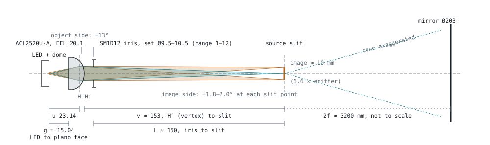

## 6. Light source

The light source is a single assembly utilizing the common post support
([§5](05-post-support.md#5-rail-mounted-posts)). An internally threaded mount carries an interchangeable LED
module on its rear face, and a condensing lens and iris on its forward face. The condenser images the LED
emitter onto the source slit ([§7](07-source-slit.md#7-source-slit)) ahead, and the iris sets the angular size
of the illumination cone. The model is `src/schlieren/parts/light_source.py`.

  
   
  <em>Fig. 4. Light source on its post and rail shoe</em>

### 6.1 Assembly and stack order

From the LED toward the slit:

1. LED module;
2. Thorlabs SMR1/M mount;
3. Thorlabs SM1V05 adjustable lens tube;
4. Thorlabs ACL2520U-A condensing lens seated in the lens tube;
5. Thorlabs SM1L03 spacer ring, to provide relief between the lens vertex and the iris ahead;
6. Thorlabs SM1D12 adjustable iris.

  
   
  <em>Fig. 5. Light-source cutaway, showing internal position of LED carrier and condensing lens</em>

The LED modules and the condenser lens holder share opposite sides of the SMR1/M mount thread. The module
threads in until seated against the rear SMR1/M face, providing reapeatable LED positioning, and the remaining
forward thread is used by the lens holder for focus adjustment.

### 6.2 LED modules

The LED modules are constructed around Thorlabs SM1CP2M SM1 externally threaded solid aluminum end caps. Each
cap is drilled and tapped so an LED carrier board can be screwed to its front face and a heatsink screwed to
its rear face. The cap's external SM1 thread then serves as the module interchange standard, supporting and
aligning the module in the assembled light source.

Each LED module has a pair of 18 AWG power leads exiting between its heatsink pins columns, terminated in a
Molex Micro-Fit 3.0 connector.  A mating pigtail connects via banana-plugs to an ALIENTEK DP100 30V 5A
adjustable CC/CV DC power supply (Amazon B0CWRG6YFM).

#### LEDs

The LEDs chosen are on industry-standard 20 mm "star" MCPCB carriers:

| Module | Emitter                             | Board                                    | Initial operating current (mA) |
| ------ | ----------------------------------- | ---------------------------------------- | ------------------------------ |
| Green  | OSRAM OSLON SSL 120, 530 nm nominal | NewEnergy star board, LST1-01F06-GRN1-00 | ~350                           |
| White  | Nichia 519A R9080, 5000 K           | Convoy 20 mm star/DTP carrier            | ~500–700                       |

Each star board is fastened to its module with a pair of M2 x 6 mm screws through board slots into tapped
holes on the front of the cap; slightly oversized board slots permit final centering of the emitter on the cap
axis. A thin insulating washer goes under each screw head, keeping the metal head off exposed board contacts
and spreading clamp contact over the board slot. A thin layer of thermal compound is used between board
and cap.

Power leads drop past the star board's flat edges and pass out through two Ø2.0 mm holes in the cap and
heatsink base, positioned inside the cap thread relief.

The white LED dissipates about 2 W at 700 mA, for a predicted steady state temperature rise roughly 14 °C
above ambient. The green module at 350 mA dissipates about 1.1 W. **Provisional:** bench-test the predicted
temperature rises.

#### Heatsink

- Alpha CN40-40B natural-convection pin-fin heatsink, one per module
- 6063 aluminum, black anodized; 24.6 g
- Ø40.0 mm × 40 mm overall, 3.0 mm flat base, Ø2.8 mm pins on a 6.9 mm square grid
- manufacturer natural-convection rating 6.9 °C/W

The above rating is the manufacturer's pins-up test; the module runs with pins horizontal, which pin fins
tolerate well.

The heatsink and cap are fastened with three M3 × 6 mm socket-head screws run through drilled clearance holes
in the heatsink base into corresponding tapped M3 holes in the cap. The screws are positioned so their heads
seat against the rear of the heatsink base in open cells between sets of four pins. Three such screws hold the
heatsink without a rocking axis. A thin layer of thermal compound is also used between the heatsink and the
cap.

The heatsink base also has drilled holes to accommodate exit of the LED power leads, which are run out between
pin columns.

#### Cap and heatsink hole layout

The drill and tap prescriptions for the cap and heatsink are as follows.  Coordinates are in millimeters from
the optical axis, +x to the right and +y up as seen from the LED side, in the frame of the heatsink pin
lattice:

  
   
  <em>Fig. 6. Cap and heatsink hole layout, seen from the LED side.  Grey: heatsink; orange: cap; blue:
  20 mm star; red: M3 hardware; green: M2 hardware</em>

| Hole      | Position                                       | In the cap               | In the heatsink base |
| --------- | ---------------------------------------------- | ------------------------ | -------------------- |
| M3, three | (+6.90, +6.90), (−6.90, +6.90), (+6.90, −6.90) | Ø2.5 tap drill, M3 × 0.5 | Ø3.3 clearance       |
| M2, two   | (±9.30, 0)                                     | Ø1.6 tap drill, M2 × 0.4 | none                 |
| Lead, two | (0, ±11.0)                                     | Ø2.0                     | Ø2.0                 |

All holes in the cap and in the heatsink base are **through holes**, drilled from one face. Plain plug taps
cut full threads through them; no bottoming taps are required. No screw reaches the far face of the cap in
either direction: the M2 screws are 6 mm under the head, about 4 mm of it in the cap from the front past the
board and washer, and the M3 screws engage about 3 mm into the cap from the back past the 3.0 mm heatsink
base.

#### Drilling fixtures

In practice, the cap and heatsink require fairly precise drilling; the lead holes' outer edges, for example,
leave only about 0.55 mm to the cap's outer thread relief. The Ø2.0 mm lead hole alignment between cap and
heatsink must also be kept pretty tight to avoid impinging the Ø1.7 mm leads passing through both. To this
end, a bushed drill template and custom alignment nests for both the caps and heatsink were designed. The
model for these is `src/schlieren/parts/led_drill_fixture.py`.

  
   
  <em>Fig. 7. Drilling fixtures: bushing plate on the cap nest (left) and on the heatsink nest (right)</em>

A single **bushing plate** serves both parts, so the lead exit holes and the M3 holes that fix the
cap-to-heatsink rotation are drilled from the same coordinates. A matching **cap nest** and a **heatsink
nest** each locate one type of part beneath. All are printed in PLA, with a keyed registration between cap and
nests allowing only a single assembled orientation for each.

Selected hardened steel metric press-fit drill bushings for the plate are as follows:

| Hole           | Count | Bore (mm) | Outside diameter (mm) | SKU                |
| -------------- | ----- | --------- | --------------------- | ------------------ |
| M2 tap drill   | 2     | 1.6       | 4                     | McMaster 96990A132 |
| M3 tap drill   | 3     | 2.5       | 5                     | McMaster 96990A147 |
| Lead hole      | 2     | 2.0       | 5                     | McMaster 96990A139 |

The bushing plate bores are drawn over the bushing outside diameter to allow for printed hole undercutting.
They give a press fit, found with the bore coupon (`led_drill_bore_coupon`, 0.00 to 0.20 mm over in 0.05 mm
steps). A little low-viscosity cyanoacrylate, wicked in around each bushing, retains it.

The bushing plate seats on each nest's top face, and is held there during drilling by four M3 × 12 mm screws
through corner clearance holes in the bushing plate into brass flanged heat-set inserts in each nest's
corners. The nests are designed to leave a 2.0 mm gap between the bottom of the plate and the top of the
drilled surface to accommodate drill chips. A boss under the center of the bushing plate carries a disc of the
1/32 in adhesive-backed EPDM sheet (McMaster 9852N37; the same sheet used elsewhere). Seated, that disc
presses down on the drilled part's top face with about 0.3 mm of compression to help restrain the part against
wobble or bit grabbing.

The cap nest additionally has an M3 x 12 mm side clamp screw through a heat-set insert which bears against the
knurled edge of the held cap, while the heatsink nest has a cross-shaped rib that engages between the held
heatsink's pins opposite the drilling surface.  Both of these measures restrain the held parts against
rotation within their nests while drilling.

The nests as modeled mount on the base of a Dremel 220 drill press, which has four diagonal keyhole slots.
Each nest inself has two slotted ears, on its ±x faces.  The nests sit turned 45° on the drill press base so
their x axis lies along one pair of base slots. One carriage bolt on each side extends upward through a drill
press base slot, through a nest ear and a flat washer, and engages a flanged knurled thumb nut at the top of
the stack. The fixture can thus be located in x along the base slots, and in y along the ear slots, enough to
bring any bushing under the drill drill spindle.

Both types of parts are drilled through the plate from the LED-side face. To move between holes, loosen the
thumb nuts, lower the bit into the next bushing and hold it there, and tighten the thumb nuts; the bushing
sets the fixture's position.

- Caps: all seven holes, through. Then tap the M3 and M2 holes by hand.
- Heatsinks: the three M3 positions the two lead holes.  Then open the M3 holes to Ø3.3 clearance with a hand
  drill at low speed.

The plate carries all seven bushings for both parts, but the M2 positions are not drilled in the heatsink.

### 6.3 Condenser optics

The condenser images the LED emitter onto the source slit (about 6.9× magnification). Each slit point receives
light from its conjugate emitter point through the full iris aperture, so its cone is uniformly filled in angle.
Emitter structure appears as intensity variation along the slit, not as structure in the mirror illumination. The
LED image should cover the illuminated slit length; the domes enlarge the apparent emitters by about 1.4–1.5×.
The image's brightest portion is about 10.4 mm long, as calculated, with a weaker shoulder that extends to about
±7.8 mm. The shoulder was measured at ±7.5 mm from the wall image (iris open, slit removed) at 6.6×, 153 mm from
the lens vertex to the slit, and the model scales it to the present magnification
(`LightSourceParameters.lit_half_length`). The clearances of the slit head and field lens
([§7.2](07-source-slit.md#72-architecture), [§7.9](07-source-slit.md#79-field-lens)) use that extent.

**Field lens.** A slit point's cone is centered on the chief ray from the center of the iris to that point, not on
the mirror. The iris leaves are about 150 mm behind the slit (the 159 mm from the lens's convex vertex less the
9.4 mm to the leaves, below) and the mirror 3200 mm ahead of it, so for a point a distance h along the slit
the chief ray is tilted by about h/150, and the cone's footprint on the mirror is displaced by about
h (1 + 3200/150) ≈ 22 h: 116 mm at the end of the brightest portion of the slit (h = 5.2 mm) and 176 mm at the
edge of the shoulder (h = 7.8 mm), more than the mirror's 101.5 mm radius. Each slit point lights a mirror-sized
disk, but the disks' centers are spread along the slit, so without a correction the illumination falls along the
slit to about 55 % of its central value at the mirror's edge. A field lens just ahead of the slit removes the
spread ([§7.9](07-source-slit.md#79-field-lens)): it images the iris onto the mirror, which aims every chief ray
at the mirror's center, so the cones from all slit points overlap there.

The lens is the Thorlabs LA1433-A (f = 149.5 mm), and the slit's distance from the condenser is chosen for it.
With the lens at the position of §7.9, its focal length images onto the mirror an iris about 157 mm behind its
object-side principal plane, which puts the iris leaves about 150 mm behind the slit. The condenser's conjugates
follow from that distance (below), and in turn the gap that focuses the emitter on the slit. Every cone then
centers on the mirror (paraxially, within 0.1 mm, from any point of the lit slit). A lens ahead of the slit leaves
the condenser's conjugates, the lit length, and the focus of the LED image on the slit unchanged. It converges
each cone by about 5 %, so the iris is set to about Ø10.0 mm, a cone of ±1.91° at the slit, for the cone to reach
the mirror's edge from every point of the lit slit.

Defocus in either direction underfills the ±1.82° cone: iris-edge rays then trace back beyond the emitter
edge, darkening the mirror edge and shortening the uniformly lit slit length. With the LED at the condenser
focus (12 mm, collimated) the emitter cannot fill the cone even at the slit center.

The iris-to-slit distance follows from the stack ([§6.1](#61-assembly-and-stack-order)): the leaves of the
SM1D12 lie 9.4 mm ahead of the lens's convex vertex. That is 0.7 mm for the vertex's depth inside the SM1V05's
open end (the 12.0 mm lens in its 12.7 mm seat), 8.38 mm for the SM1L03 (the iris's thread shoulder seats on
its open end), and 0.36 mm for the leaves' midplane past that shoulder. The last is from the vendor model,
whose 10 leaves span 0.76 mm before to 1.47 mm past the shoulder; the vendor drawing does not locate them.
With 159 mm from the vertex to the slit, the leaves are 149.6 mm from the slit.

Using ACL2520U-A catalog values (EFL 20.1 mm, BFL 12.0 mm; object-side principal plane about 8.1 mm inside the
plano face) and 159 mm from the convex vertex to the slit, the optimum emitter-to-plano-face gap is about
14.9 mm. The optimum moves only about 0.5–0.8 mm for 30 mm of slit position either way.

  
   
  <em>Fig. 8. Condenser layout unfolded (mirror reflection removed). Axial and transverse scales match from
      the LED to the slit; the slit-to-mirror span and the cone beyond the slit are not to scale. Teal: the
      on-axis emitter point; amber: the two emitter edges</em>

The prescription, with the basis of each value:

| Element                           | Value                                           | Basis                                                                                                              |
| --------------------------------- | ----------------------------------------------- | ------------------------------------------------------------------------------------------------------------------ |
| Emitter (apparent, through dome)  | ≈ 1.5 mm (green)                                | Estimate: ~1 mm die scaled from the OSRAM outline × 1.4–1.5 dome; white 519A phosphor size not recorded            |
| Emitter to plano face             | 14.91 mm (13–17 usable)                         | Calculated optimum for 159 mm vertex-to-slit                                                                       |
| ACL2520U-A condenser              | EFL 20.1, BFL 12.0, NA 0.60, CA > 22.5          | Catalog; object-side principal plane H at EFL − BFL = 8.1 mm inside the plano face                                |
| Conjugates                        | u 23.01, v 159, m ≈ 6.9                         | Calculated from 1/u + 1/v = 1/f; u from H, v from the image-side principal plane H′ at the convex vertex          |
| SM1D12 iris                       | Ø1–12 range; ≈ Ø10.0 set                        | Catalog range; setting calculated as D = 2 · L · tan θ at L = 149.6 mm, θ = 1.91°, the cone that the field lens converges onto the mirror's ±1.82° from every point of the lit slit |
| Iris leaves to slit               | 149.6 mm (leaves 9.4 mm ahead of the vertex)    | The distance at which the field lens images the iris onto the mirror; the leaves' place in the stack: vertex 0.7 mm inside the SM1V05 open end, SM1L03 8.38 mm, leaf midplane 0.36 mm past the SM1D12 shoulder (vendor model); 159 mm vertex-to-slit |
| Source slit                       | 0.10–0.30 wide, 10.4 mm lit length              | [§7](07-source-slit.md)                                                                                            |
| Field lens                        | LA1433-A, Ø1 in, f 149.5; plano face ≈ 5 mm ahead of the slit | Catalog; the slit is placed for this focal length to image the iris onto the mirror (above); [§7.9](07-source-slit.md#79-field-lens) |
| Mirror                            | f 1600; slit at 2f = 3200 mm, ±101.5 mm, ±1.82° | Catalog D203F1600; slit at the center of curvature ([§3.2](01-context-and-layout.md#32-source-cone)); ±2.0° gives slight overfill     |

Each emitter point sends a cone of about ±13° into the lens, and its image point receives a cone of about
±1.9°. The iris sits in the converging space and sets that angle, so all emitter points share it.

Moving the LED re-establishes the conjugates with the same lens: the slit moves to stay in focus and the iris is
resized to keep the cone that fills the mirror. The lit length is the apparent emitter (≈ 1.5 mm) times m, and the flux
through the slit scales with it:

| Gap g    | m     | v (vertex to slit) | Iris needed (D = 2 L tan θ, θ = 1.82–2.0°) | Lit length | Result                                                                            |
| -------- | ----- | ------------------ | --------------------------- | ---------- | --------------------------------------------------------------------------------- |
| 14 mm    | 10.1× | ≈ 222 mm           | ≈ 13.5–15 mm                | ≈ 15 mm    | Iris cannot open far enough (12 mm maximum); image longer than the 10 mm needed   |
| 14.91 mm | 6.9×  | ≈ 159 mm           | 9.5–10.4 mm                 | ≈ 10.4 mm  | Design point; the slit distance the field lens needs, and the image covers the lit length (green) |
| 16 mm    | 5.0×  | ≈ 121 mm           | ≈ 7–8 mm                    | ≈ 7.5 mm   | About 25% less light through the slit; the iris is then about 112 mm from the slit, so the field lens (matched to about 150 mm) leaves the lit end's cone about 39 mm off the mirror's center; a lens of about 115 mm would center it |

#### Focus

The LED module seats against the rear face of the SMR1/M ([§6.1](#61-assembly-and-stack-order)), which fixes the
emitter, and the SM1V05 sets the lens position by how far it is threaded into the SMR1/M. Each millimeter of
added engagement moves the lens a millimeter closer to the emitter, so the engagement range sets the range of
reachable emitter-to-plano gaps. Engagement runs from the Thorlabs minimum of 2.79 mm to about 5.7–5.8 mm, where
the sleeve end comes within 0.3 mm of the LED board. Turning the SM1V05 moves the lens and iris together, but
the resulting few-millimeter iris shift is negligible against the 150 mm iris-to-slit spacing, so the iris
setting is unaffected. The gap is measured to the emitting surface, not the dome top.

The emitter heights above the cap face are calculated from the measured board thicknesses, about 0.07 mm of
solder, and the apparent emitter heights through the LED domes (from the manufacturer outline drawings: OSLON
about 0.45 mm, 519A about 0.75 mm). With them, each module reaches the following gap range over the engagement
range:

| Module | Emitter height above cap face | Emitter-to-plano gap range | SM1V05 engagement at 14.91 mm gap |
| ------ | ----------------------------- | -------------------------- | ------------------------------ |
| Green  | about 2.1 mm                  | about 13.2–16.2 mm         | about 4.1 mm                   |
| White  | about 2.3 mm                  | about 12.9–16.0 mm         | about 3.9 mm                   |

Focus margin about the 14.91 mm optimum gap is about 1.3 mm (long-gap side) and 1.7 mm (short-gap side) for
the green module, and about 1.1 mm and 2.0 mm for the white module. The white module's long-gap margin is the
smallest, its travel limited by the SM1V05 minimum engagement. **Provisional:** the white module's long-gap
margin is to be confirmed on the build. If it cannot reach a sharp emitter image on the slit, space its cap
flange off the SMR1/M face with a thin shim; each 0.1 mm of shim adds about 0.1 mm of long-gap margin. The shim moves the
whole module away from the lens and keeps the flange as the axial stop; a shim under the star board would
instead shorten the gap and make the shortfall worse.

To set up, thread the SM1V05 in to the engagement above for the module in use, set the iris to about Ø10.0 mm,
and place the slit head about 150 mm from the iris leaves (159 mm from the lens vertex). The blades of the stage-based slit head cannot be seen, so
swap the printed focus target in for the head ([§7.7](07-source-slit.md#77-slit-focus-target)), with the field
lens station slid clear ([§7.9](07-source-slit.md#79-field-lens)), turn the SM1V05 until the emitter image on
the target is sharp and centered, then lock the SM1NT, restore the slit head and the field lens, and open the
slit. The two modules focus about 0.2 mm apart in engagement, about one-third of a turn of the SM1
thread; an index mark per module on the SM1V05 is optional.

In transport, the condenser/iris assembly is protected from dust and scratches by a Thorlabs SM1CP1 internally
threaded end cap and an SM1EC2 snap-on dust cap.
