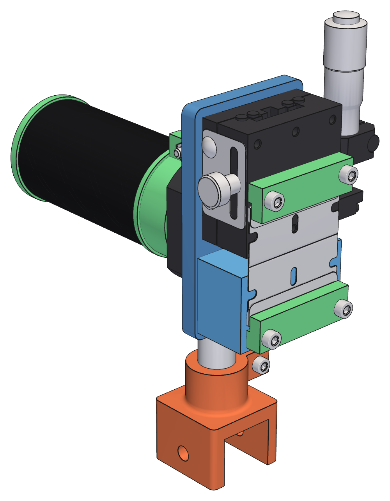
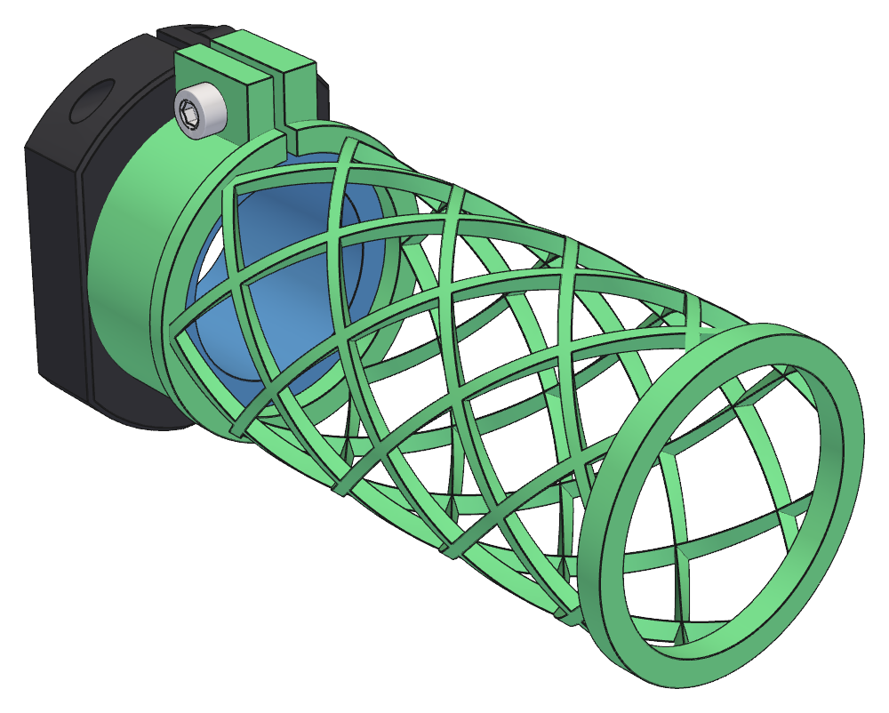

## 6. Source slit

The source slit is a pair of razor blades, one on the table of a purchased 40 × 40 mm linear stage and one on a
printed pedestal, with the stage's micrometer setting the slit width. The head is mounted for continuous
rotation about the optical axis in an SM1RC/M on the common post and rail shoe. A baffle behind it on the source side is clamped on the
head's spigot and turns with it, a field lens on a post of its own ahead of the blades
makes the mirror illumination uniform, and a printed focus target stands in for the
head to focus the LED image.

The model is `src/schlieren/parts/slit_stage.py` (`uv run slit-stage`, with `--show` for the viewer assembly).

The slit needs one adjustment, its width, and no interchangeable elements, so a purchased stage with a
micrometer serves where the cutoff uses a carriage and cassettes.

### 6.1 Blades and slit widths

The slit uses two Stanley 11-515 backed single-edge scraper blades.

Measured physical blade dimensions:

- length: 1.537 in / 39.04 mm
- width, cutting edge to the outside of the fold: 0.773 in / 19.64 mm
- plate thickness: 0.010 in / 0.254 mm
- fold: the back edge is folded over both faces, 0.277 in / 7.04 mm deep on each, 0.040 in / 1.016 mm thick across
  the fold
- bevel on both faces, breaking 0.030 in / 0.76 mm back from the cutting edge

The blade has a slot at mid-length and a notch in each end, approximated in the CAD from a photograph (about
±0.3 mm); the slit and cassette fixtures do not rely on them. The CAD model is `parts/razor_blade.py`.

The working slit widths are in the slit and field lens section of the optical layout.

Each blade lies on its fold, flat on its seat, the stage table or the pedestal, cutting edge toward the slit and
overhanging the seat edge by 2.9 mm. The fold's outer layers stand 0.38 mm proud of the plate's faces, so with the
fold's outer layer on the seat the plate is parallel to it, 0.38 mm above it and clear of its edge, and the cutting
edge's mid-plane is 0.51 mm above the seat plane. No blade pockets, holes, or spine compensation are used. The
optically important geometry is the gap and the parallelism of the two cutting edges: the two blades are identical
and seated alike, so their edges lie at the same height, collinear were the slit closed, to within the difference
of the two folds' thicknesses. The 12.6 mm of plate in front of the fold is a stiff cantilever: calculated, its own
weight deflects it by about 0.2 µm and its first resonance is about 1.3 kHz.

### 6.2 Architecture

The head is a stage plate carrying the stage and a pedestal:

1. stage plate: a 6 mm printed plate with the spigot and shoulder for the SM1RC/M;
2. stage: a 40 × 40 mm linear stage with a micrometer drive (Amazon B0B7RVW3SX, an SF Technology SEMX40-AS
   type, ±6.5 mm of travel), bolted to the plate front; its table carries the movable blade;
3. pedestal: a printed block on the plate carrying the stationary blade at the same height as the table.

Local frame, at rotation 0: $x$ along the slit, $z$ the adjustment axis with the micrometer toward $+z$, $y$ along the
optical axis toward the mirror; the origin is the slit center in the blade-seat plane. The blade-seat plane
(the table top and the pedestal top) is the front of the head; the stage's 20 mm thickness puts it 20 mm ahead
of the plate front. In this section "front" and "back" refer to the head, not to the rail direction.

The head's front faces the mirror. The light comes from the source side through the baffle and the plate's
Ø24 mm bore and passes the stage's edge to reach the slit from behind, so the spigot, ring, and post are on the
light-source side of the blades. The source cone is ±2° about the chief ray and the lit slit length extends to ±7.8 mm; the stage and pedestal edges keep 1.65 mm from the cone.

  
   
  <em>Fig. 9. Stage slit head and baffle on its post and rail shoe, seen from the mirror side: the
    movable blade on the stage table, the stationary blade on the pedestal, a toe bar over each, and the
    micrometer up</em>

### 6.3 Slit width

- drive: the stage's micrometer, moving the table and so the movable blade; travel ±6.5 mm (manufacturer);
- the slit is 0.2 mm in the model, within the working range.

There is no centering stage. Only the movable blade moves, so a width change shifts the slit center by half the
change; the effect on the illumination is in the slit and field lens section of the optical layout.

Slit setup:

1. with both toe bars loose, bring the movable blade to the pedestal blade with the micrometer;
2. seat both blades and clamp them progressively;
3. set the width against a true-metric feeler gauge between the cutting edges, pressing gently along their
   length;
4. thereafter set the width with the micrometer from that reference, re-checking parallelism with the gauge
   after large width changes.

### 6.4 Blade clamping

Each blade is held on its seat by a printed PLA toe bar. One bar sits on the stage table and one on the
pedestal; each is screwed down at its two ends into the stage's M3 table holes (second row, 16 mm pitch) or
into M3 heat-set inserts (McMaster 97171A310) in the pedestal. The bar's finger runs the length of the blade and
presses the rear 3 mm of the blade's fold flat onto the seat through a strip of 1/32 in EPDM (McMaster 9852N37,
the same stock as the frame's yaw clamps). The finger does not touch the plate or the cutting
edge, and no blade is drilled.

The clamp holds the blade only against its own weight and handling and alignment loads, a small force, and the
fold is stiff. The toe's squeeze on the EPDM pad is 0.3 mm, which puts the finger's underside 1.51 mm above the
seat plane: the fold's 1.02 mm plus the compressed pad. The finger's slit-side face stands 16.2 mm from the
optical axis, 1 mm clear of the Ø30.5 mm body of the field-lens tube, which stands
between the two fingers over the axis; the head turns about that axis, so the fingers clear the tube at every
angle. The common McMaster 91292A114 M3 × 12 mm screw is used.

### 6.5 Rotation mount and clearances

The stage bolts to the plate front with four M3 screws on its 32 mm base-hole pitch, with captive M3 nuts (the
common 91828A211) in pockets in the plate rear. The pedestal is screwed to the plate from the rear into two M3
heat-set inserts in the pedestal (97171A310).

The plate carries a hollow Ø30.48 mm (SM1 tube OD) spigot with a Ø24 mm light bore, clamped by the SM1RC/M
split ring (Ø30.7 mm bore, 10.16 mm thick, M4 locking screw across the split). A Ø34 mm shoulder on the spigot
is the ring's axial stop: the ring seats against it, which places the plate 3.5 mm in front of the ring face.
Do not clamp the ring away from the shoulder. The nut pockets reach inside the spigot's radius, so the spigot
is restored behind the shoulder and roofs them, and the ring grips a full cylinder.

The spigot runs the ring's full thickness and protrudes 12 mm past its source face, where the baffle's clamp grips it; the ring clamps nothing else. The SM1RC/M keeps the 22.1 mm
post-top-to-axis dimension. Loosening the ring rotates the whole
head about the optical axis:

- rotation 0: horizontal slit, micrometer up;
- ±90°: vertical slit, micrometer sideways, and with the micrometer toward the imaging rail it reaches the cutoff
  carriage's base plate unless the cutoff is staggered behind the slit by about 16 mm or more (the 30–40 mm
  starting stagger clears it by about 20 mm); turned outboard it clears at
  any stagger;
- small rotations: slit-to-cutoff parallelism trim.

The rotation sweep clears the post, ring, and rail shoe in the tests.

### 6.6 Fabrication and fit

Printed parts: the stage plate, the pedestal, and two toe bars.

- Plate: print front face down, spigot up; no supports.
- Pedestal: print top face down, so the blade seat is the first layer.
- Toe bars: print flat, heel side down.
- The spigot is printed at the SM1 tube nominal, which fits the SM1RC/M.

Hardware: the stage, 4 × M3 × 10 mm screws (91292A113, stage to plate), 4 × M3 nuts, 2 × M3 × 12 mm screws (pedestal to plate),
4 × M3 × 12 mm screws (toe bars), 4 × M3 heat-set inserts, 2 strips of EPDM.

**Provisional:**

- The stage's dimensions are the manufacturer's (the table layout, 20 mm thickness, ±6.5 mm travel), not
  measurements of the stage on hand. The model shows Misumi's XCRS40, which has the same table and base layout
  and a solid CAD model. The base-hole pitch, the table's tapped holes, the micrometer reach, and the base
  flange thickness are to be measured, and the base mounting holes (four M3, counterbored) are assumed reachable
  from the table side.
- The blade overhang and the toe bar's squeeze on the EPDM pad (0.3 mm) are first-print values, as is how flat
  the stamped folds lie on the seats and under the pad.
- The M3 × 10 mm stage screws leave about 1 mm of thread behind the plate, 2.5 mm short of the ring face, with
  the thread still showing past the nut; the length rests on the stage's base flange thickness, which is not yet
  measured.

### 6.7 Slit focus target

The emitter image is focused on the slit plane, but the blades of the head sit deep in the stage and cannot be
seen. A printed focus target swaps in for the stage plate on the same SM1RC/M ring: the same shoulder, ring gap,
and spigot grip, then a hollow barrel that widens to a Ø40 mm rim whose face is the plane of the blades' cutting
edges, 0.51 mm ahead of the blade-seat plane. The Ø24 mm bore tapers in at 45° to Ø20 mm at the rim face, which
gives the glass a wide seat and the insert recesses a thicker wall; the beam there is about Ø11 mm. The target's
spigot ends flush with the ring's source face, so the baffle is taken off the plate's spigot first: loosen its
clamp screw and slide it off. The models are `src/schlieren/parts/slit_focus_target.py` (`uv run
slit-focus-target`, with `--show` for the viewer assembly).

A Ø1 in ground-glass disc (Thorlabs DG10-600, 2.0 mm thick) is the screen. It lies on the rim, ground face
toward the source, in a Ø25.7 mm pocket in the rear face of a printed retaining ring, so the imaging surface is
the blades' edge plane whatever the glass thickness. A gasket cut from 1/16 in Durometer 30A neoprene sheet,
between the glass's front face and the pocket ceiling, pushes the glass back onto the rim and absorbs any spread
in its thickness. The disc has a 0.2 mm × 45° bevel on both edges (Thorlabs model; the drawing does not dimension
it), so its flat faces are Ø25.0 mm, and the gasket is cut to that: an annulus Ø20 mm inside, Ø25.0 mm outside.

The ring is Ø40 mm and 4.65 mm thick (3.15 mm pocket, 1.5 mm lip). Its Ø20 mm window matches the seat bore at the
rim face, so the lip passes the whole beam and stays within the plate's Ø24 mm bore, and the flat seats on 2.5 mm
of the rim, outside the seat bore. The window's mirror-side edge has a 1 mm × 45° bevel for a wider viewing angle,
and the screw heads bear outside it. Four M3 × 10 mm socket-head screws (SLT-022, 91292A113) on a Ø32 mm circle
run into heat-set inserts (97171A310) in the rim. The glass is set on the rim, then the gasket, then the ring over
both. The LED image forms on the ground face and is read through the glass from the mirror side, so the turn of
the SM1V05 can be judged by eye before the head is fitted. For handling, the rim's back edge and the ring's front
edge, both Ø40 mm, have a 0.5 mm chamfer; the mating faces keep sharp edges.

### 6.8 Baffle

A baffle sits on the source side of the slit head, on the optical axis: one printed part, a clamp ring on the
plate's spigot followed by a net of crossed helical vanes that carries a matte black foil wrap. It is built from the spigot out,
so the posts, shoes, and optical-mechanical rings of the other stations are not needed.

  
   
  <em>Fig. 10. Baffle on the plate's spigot, seen from the source side, without its foil wrap: clamp ring,
    near rib, net, far rib</em>

**Motivation.** The condenser focuses the LED image, about 10 mm across, on the blades, and a slit of 0.10–0.30 mm passes only a small fraction of it.
The blades return the remainder, and the head's lit surfaces scatter some of it. That light goes back toward
the source as a broad cloud, strikes the bare post, the source hardware, and the table behind the head, and is
forwarded by them, glossy surface to glossy surface, toward the mirror and the operator at the imaging
station. The cloud lights the room and adds veiling glare to the image. A tube immediately behind the head
confines the return to the direction of the LED: it travels back through the bore toward the iris, and the
rest meets the black walls and vanes.

**Beam.** The baffle bounds the light but does not stop down the beam, which is about Ø16 mm over the whole baffle. The bore is
Ø30.68 mm, the clamp's, so it leaves about 7 mm of radius all around and is wider than the plate's Ø24 mm spigot bore;
no alignment tolerance clips the beam, and the length is set by the clamp and the distance to the iris, not by the
beam. It ends 81 mm from the ring's source face, about 21 mm short of the iris housing. At the slit end the beam
is bounded by the head instead, not the baffle: the stage and pedestal edges keep 1.65 mm from the cone.

**Mount.** The plate's spigot protrudes 12 mm past the SM1RC/M's source face. The baffle's clamp ring, 12.5 mm
long, fits over that end and butts the ring's face, which sets its axial position. The clamp is built as the
rail shoe's collar is: a Ø30.68 mm bore (0.20 mm diametral clearance
on the spigot), a 1.5 mm split along the top, and ears with one M3 × 12 mm screw (91292A114) and a captured M3
nut (91828A211), 3.5 mm ear on the screw side and 4.5 mm on the nut side. The split continues through the near
rib behind the clamp and opens into the net's first cell, so the net's vanes, not a closed ring, take the clamp's
closing. The bore stops at a shoulder 0.5 mm short of the spigot's end. The ears stand about 24 mm above the
axis at rotation 0 and turn with the head, which they clear through its working range. The baffle needs no
precision of its own: the spigot, held by the head's ring, sets its axis, and the bore's radial margin over the
beam (above) absorbs the clearance of the two printed fits.

**Net.** Behind the clamp a 2 mm solid near rib and, at the far end, a 3 mm solid far rib stand 1 mm proud of the
net's Ø36.68 mm outside diameter, which is the clamp's, so there is no step from the clamp to the net. Between
them, 63.5 mm long, the net has no tube wall: it is six right-handed and six left-handed helical vanes, each a
triangle in section whose base lies on the outside diameter, 3.5 mm wide, and whose apex stands just proud of
the bore. A vane's helix gives 45° to the axis at the wall's mid radius, so the hands cross as a diamond lattice, and the
vanes lean in 3 mm deep toward the bore. That lets the net print on end without supports and be stiff enough to
support its own length and the foil. Where the hands cross they merge into one solid whose top lies on the outside cylinder.
A stray ray that strikes a vane's flank is trapped there, where it would otherwise slide along a bare wall.

**Foil and finish.** The vanes' flanks and the bore are the baffle's absorbing surfaces: they are painted with flat
black spray paint (a rattle can, BOM SHP-040) before the foil goes on, and the clamp's bore and the spigot are
kept free of paint. The foil is Rosco Photofoil matte black aluminum wrap (BOM SHP-022), matte on both sides,
wrapped once or twice around the net's outside between the two ribs so that it covers the cells; a strip of
tape across the seam holds it. The ribs stand about 0.9 mm proud of the foil and guide its edges. Cut the strip 64 mm wide,
about 0.5 mm over the net's length, so that its edges butt against the ribs: a narrower strip leaves a gap
at each rib through which light from the bore escapes through the first row of cells. Its length is one turn, about 116 mm
(the circumference at the foil), plus about 5 mm of overlap for the seam, and about 116 mm more for a second turn.
Wrapping the outside avoids fitting a liner into the bore.

**Fabrication.** Print on end, clamp end down, in PLA, without supports; the ears and split lie along the
layers. The model is `src/schlieren/parts/baffle.py` (`uv run baffle`, with `--show` for the viewer assembly),
and `slit_stage.py` shows it with the head.

**Provisional:** the clamp's bore clearance and split gap are first-print values, to be settled with a coupon
print; the net's stiffness as a cantilever of its own length, the vanes' depth, and the effect of the painted
vanes on the glare are to be confirmed on the bench.
