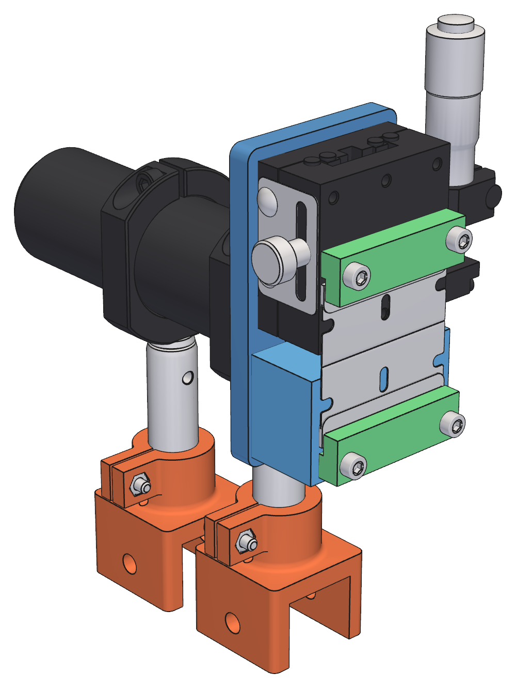
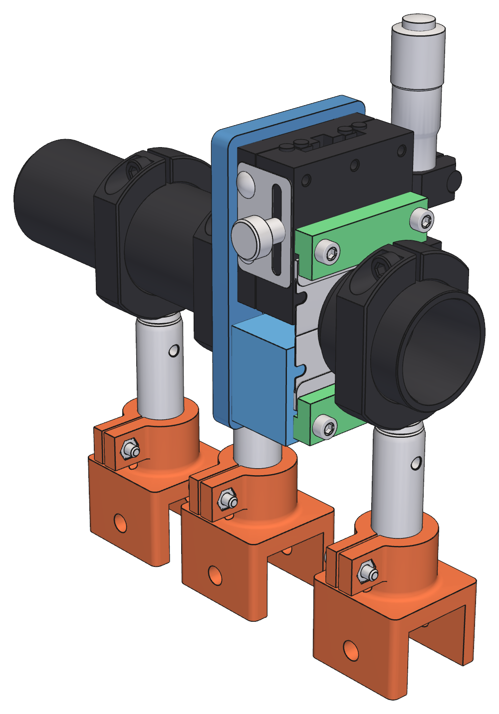

## 7. Source slit

The source slit is a pair of razor blades, one on the table of a purchased 40 × 40 mm linear stage and one on a
printed pedestal, with the stage's micrometer setting the slit width. The head is mounted for continuous
rotation about the optical axis in an SM1RC/M on the common post and rail shoe
([§5](05-post-support.md#5-rail-mounted-posts)). A baffle tube behind it on the source side is
clamped on a post of its own ([§7.8](#78-baffle-tube)), a field lens on a post of its own ahead of the blades
makes the mirror illumination uniform ([§7.9](#79-field-lens)), and a printed focus target stands in for the
head to focus the LED image ([§7.7](#77-slit-focus-target)).

The model is `src/schlieren/parts/slit_stage.py` (`uv run slit-stage`, with `--show` for the viewer assembly).

The slit needs one adjustment, its width, and no interchangeable elements, so a purchased stage with a
micrometer serves where the cutoff uses a carriage and cassettes ([§8](08-cutoff.md#8-cutoff)).

### 7.1 Blades and slit widths

The slit uses two Stanley 11-515 backed single-edge scraper blades.

Measured physical blade dimensions:

- length: 1.537 in / 39.04 mm
- width, cutting edge to the outside of the fold: 0.773 in / 19.64 mm
- plate thickness: 0.010 in / 0.254 mm
- fold: the back edge is folded over both faces, 0.277 in / 7.04 mm deep on each, 0.040 in / 1.016 mm thick across
  the fold
- bevel on both faces, breaking 0.030 in / 0.76 mm back from the cutting edge.

The blade has a slot at mid-length and a notch in each end, approximated in the CAD from a photograph (about
±0.3 mm); the slit and cassette fixtures do not rely on them. The CAD model is `parts/razor_blade.py`.

Expected operating slit widths are 0.10–0.30 mm, starting around 0.15–0.20 mm.

Each blade lies on its fold, flat on its seat, the stage table or the pedestal, cutting edge toward the slit and
overhanging the seat edge by 2.9 mm. The fold's outer layers stand 0.38 mm proud of the plate's faces, so with the
fold's outer layer on the seat the plate is parallel to it, 0.38 mm above it and clear of its edge, and the cutting
edge's mid-plane is 0.51 mm above the seat plane. No blade pockets, holes, or spine compensation are used. The
optically important geometry is the gap and the parallelism of the two cutting edges: the two blades are identical
and seated alike, so their edges lie at the same height, collinear were the slit closed, to within the difference
of the two folds' thicknesses. The 12.6 mm of plate in front of the fold is a stiff cantilever: calculated, its own
weight deflects it by about 0.2 µm and its first resonance is about 1.3 kHz.

### 7.2 Architecture

The head is a stage plate carrying the stage and a pedestal:

1. stage plate: a 6 mm printed plate with the spigot and shoulder for the SM1RC/M;
2. stage: a 40 × 40 mm linear stage with a micrometer drive (Amazon B0B7RVW3SX, an SF Technology SEMX40-AS
   type, ±6.5 mm of travel), bolted to the plate front; its table carries the movable blade;
3. pedestal: a printed block on the plate carrying the stationary blade at the same height as the table.

Local frame, at rotation 0: x along the slit, z the adjustment axis with the micrometer toward +z, y along the
optical axis toward the mirror; the origin is the slit center in the blade-seat plane. The blade-seat plane
(the table top and the pedestal top) is the front of the head; the stage's 20 mm thickness puts it 20 mm ahead
of the plate front. In this section "front" and "back" refer to the head, not to the rail direction.

The head's front faces the mirror. The light comes from the source side through the baffle tube and the plate's
Ø24 mm bore and passes the stage's edge to reach the slit from behind, so the spigot, ring, and post are on the
light-source side of the blades. The source cone is ±2° about the chief ray and the lit slit length is ±5 mm
([§6.3](06-light-source.md#63-condenser-optics)); the stage and pedestal edges keep 1.65 mm from the cone.

  
   
  <em>Fig. 9. Stage slit head and baffle tube on their posts and rail shoes, seen from the mirror side: the
    movable blade on the stage table, the stationary blade on the pedestal, a toe bar over each, and the
    micrometer up</em>

### 7.3 Slit width

- drive: the stage's micrometer, moving the table and so the movable blade; travel ±6.5 mm (manufacturer);
- the slit is 0.2 mm in the model, within the 0.10–0.30 mm working range of [§7.1](#71-blades-and-slit-widths).

There is no centering stage. Only the movable blade moves, so a width change shifts the slit center by half the
change. The iris is about 150 mm before the slit, so moving the slit by d turns the illumination cone by d/150;
at the mirror the beam moves about 21 × d. A 0.1 mm width change therefore moves the slit center 0.05 mm and
the beam about 1 mm at the mirror, which needs no recentering (the cutoff is readjusted for any width change
in any case). With the field lens ([§7.9](#79-field-lens)) in place the beam moves only about 0.07 × d.

Slit setup:

1. with both toe bars loose, bring the movable blade to the pedestal blade with the micrometer;
2. seat both blades and clamp them progressively ([§7.4](#74-blade-clamping));
3. set the width against a true-metric feeler gauge between the cutting edges, pressing gently along their
   length;
4. thereafter set the width with the micrometer from that reference. Re-check parallelism with the gauge after
   large width changes.

### 7.4 Blade clamping

Each blade is held on its seat by a printed PLA toe bar. One bar sits on the stage table and one on the
pedestal; each is screwed down at its two ends into the stage's M3 table holes (second row, 16 mm pitch) or
into M3 heat-set inserts (McMaster 97171A310) in the pedestal. The bar's finger runs the length of the blade and
presses the rear 3 mm of the blade's fold flat onto the seat through a strip of 1/32 in EPDM (McMaster 9852N37,
the stock of [§4.3](04-frame.md#43-pivot-and-yaw-hardware)). The finger does not touch the plate or the cutting
edge, and no blade is drilled.

The clamp holds the blade only against its own weight and handling and alignment loads, a small force, and the
fold is stiff. The toe's squeeze on the EPDM pad is 0.3 mm, which puts the finger's underside 1.51 mm above the
seat plane: the fold's 1.02 mm plus the compressed pad. The finger's slit-side face stands 16.2 mm from the
optical axis, 1 mm clear of the Ø30.5 mm body of the field-lens tube ([§7.9](#79-field-lens)), which stands
between the two fingers over the axis; the head turns about that axis, so the fingers clear the tube at every
angle. The common McMaster 91292A114 M3 × 12 mm screw is used.

### 7.5 Rotation mount and clearances

The stage bolts to the plate front with four M3 screws on its 32 mm base-hole pitch, with captive M3 nuts (the
common 91828A211) in pockets in the plate rear. The pedestal is screwed to the plate from the rear into two M3
heat-set inserts in the pedestal (97171A310).

The plate carries a hollow Ø30.48 mm (SM1 tube OD) spigot with a Ø24 mm light bore, clamped by the SM1RC/M
split ring (Ø30.7 mm bore, 10.16 mm thick, M4 locking screw across the split). A Ø34 mm shoulder on the spigot
is the ring's axial stop: the ring seats against it, which places the plate 3.5 mm in front of the ring face.
Do not clamp the ring away from the shoulder. The nut pockets reach inside the spigot's radius, so the spigot
is restored behind the shoulder and roofs them, and the ring grips a full cylinder.

The spigot runs the ring's full thickness, and the ring clamps nothing else; the baffle tube
([§7.8](#78-baffle-tube)) ends 1.0 mm short of the ring's source face. The SM1RC/M keeps the 22.1 mm
post-top-to-axis dimension ([§5.1](05-post-support.md#51-post-and-shim)). Loosening the ring rotates the whole
head about the optical axis:

- rotation 0: horizontal slit, micrometer up;
- ±90°: vertical slit, micrometer sideways. With the micrometer toward the imaging rail it reaches the cutoff
  carriage's base plate unless the cutoff is staggered behind the slit by about 16 mm or more (the 30–40 mm
  starting stagger of [§3.3](01-context-and-layout.md#33-sourceimager-offset) clears it by about 20 mm); turned outboard it clears at
  any stagger;
- small rotations: slit-to-cutoff parallelism trim.

The rotation sweep clears the post, ring, and rail shoe in the tests.

### 7.6 Fabrication and fit

Printed parts: the stage plate, the pedestal, and two toe bars.

- Plate: print front face down, spigot up; no supports.
- Pedestal: print top face down, so the blade seat is the first layer.
- Toe bars: print flat, heel side down.
- The spigot is printed at the SM1 tube nominal, which fits the SM1RC/M.

Hardware: the stage, 4 × M3 × 10 mm screws (91292A113, stage to plate), 4 × M3 nuts, 2 × M3 × 12 mm screws (pedestal to plate),
4 × M3 × 12 mm screws (toe bars), 4 × M3 heat-set inserts, 2 strips of EPDM.

**Provisional:**

- The stage's dimensions are the manufacturer's (the table layout, 20 mm thickness, ±6.5 mm travel), not
  measurements of the stage on hand. The model shows Misumi's XCRS40, which has the same table and base layout
  and a solid CAD model. The base-hole pitch, the table's tapped holes, the micrometer reach, and the base
  flange thickness are to be measured, and the base mounting holes (four M3, counterbored) are assumed reachable
  from the table side.
- The blade overhang and the toe bar's squeeze on the EPDM pad (0.3 mm) are first-print values, as is how flat
  the stamped folds lie on the seats and under the pad ([§7.1](#71-blades-and-slit-widths),
  [§7.4](#74-blade-clamping)).
- The M3 × 10 mm stage screws leave about 1 mm of thread behind the plate, 2.5 mm short of the ring face, with
  the thread still showing past the nut; the length rests on the stage's base flange thickness, which is not yet
  measured.

### 7.7 Slit focus target

The emitter image is focused on the slit plane ([§6.3](06-light-source.md#focus)), but
the blades of the head sit deep in the stage and cannot be seen. A printed focus target swaps in for the
stage plate on the same SM1RC/M ring: the same shoulder, ring gap, and spigot grip, then a hollow barrel that
widens to a Ø40 mm rim whose face is the plane of the blades' cutting edges, 0.51 mm ahead of the blade-seat plane
([§7.1](#71-blades-and-slit-widths)). The Ø24 mm bore tapers in at 45° to Ø20 mm at the
rim face, which gives the paper or glass a wide seat and the insert recesses a thicker wall; the beam there is
about Ø11 mm. The baffle tube is a fixture of its own
([§7.8](#78-baffle-tube)) and stays clamped on its own post through the swap; the focus models do not show it. The
models are
`src/schlieren/parts/slit_focus_target.py` (`uv run slit-focus-target`, with `--show` for the paper variant and
`--show --glass` for the ground-glass one).

A sheet of tracing paper lies on the rim and a printed Ø40 × 4 mm retaining ring clamps it. The ring's Ø20 mm
window matches the seat bore at the rim face, so the ring clamps the full width of the rim's annulus; it passes
the whole beam and stays within the baffle tube's Ø22.9 mm bore. The window's mirror-side edge has a 1.5 mm × 45°
bevel for a wider viewing angle; the 2.5 mm land behind it clamps the paper, and the screw heads bear outside the
bevel. Four M3 × 10 mm socket-head screws (91292A113) on a Ø32 mm circle run into heat-set inserts (97171A310) in
the rim. The LED image forms on the paper's source-facing side and is read through the paper from the mirror
side, so the turn of the SM1V05 can be judged by eye before the head is fitted. The rim face is the datum, so the
paper's thickness (not yet measured; the model assumes 0.15 mm) offsets the focus plane from the blades' edge plane
by that much. For handling, the rim's back edge and the ring's front edge, both Ø40 mm, have a 0.5 mm chamfer;
the mating faces keep sharp edges.

A variant replaces the paper with a Ø1 in ground-glass disc (Thorlabs DG10 series, catalog 2.0 ± 0.2 mm thick).
The printed fixture is the same; only the retaining ring differs. The disc sits in a Ø25.7 mm pocket in the ring's
rear face, ground face toward the source, lying on the rim face as the paper does, so the imaging surface is the
blades' edge plane whatever the glass thickness (the paper's own thickness aside). A gasket cut from 1/16 in
Durometer 30A neoprene sheet, between the glass's front face and the pocket ceiling, pushes the glass back onto
the rim and absorbs the thickness spread. The disc has a 0.2 mm × 45° bevel on both edges (Thorlabs model; the
drawing does not dimension it), so its flat faces are Ø25.0 mm, and the gasket is cut to that. The ring is
4.65 mm thick (3.15 mm pocket, 1.5 mm lip) with a 1 mm × 45° bevel on the window, and takes the same M3 × 10 mm
screws. The glass is set on the rim, then the gasket, then the ring over both; the flat seats on 2.5 mm of the
rim, outside the Ø20 mm seat bore. **Provisional:** the pocket clearance is to be set from a printed coupon, and the grit
(DG10-600 to start) is to be confirmed on the bench.

### 7.8 Baffle tube

A baffle tube sits on the source side of the slit head, on the optical axis. Two Thorlabs
SM1L15 lens tubes (1.5 in thread depth), threaded together, form a tube Ø30.48 mm outside, 80.6 mm long, with a
Ø22.9 mm clear bore (the SM1L15 retaining-ring bore). It is clamped in a Thorlabs SM1RC/M split ring on its own
post, datum shim, and rail shoe ([§5](05-post-support.md#5-rail-mounted-posts)), 40 mm upstream
of the slit head's post, so the two shoes leave 10 mm of rail between them. The tube's open end stops 1.0 mm
short of the head ring's source face, 40.7 mm behind the blade-seat plane, and the tube
projects 34.6 mm past its own ring toward the source, ending about 29 mm short of the iris.

**Motivation.** The condenser focuses the LED image, about 10 mm across, on the blades
([§6.3](06-light-source.md#63-condenser-optics)), and a slit of 0.10–0.30 mm passes only a small fraction of it.
The blades return the remainder, and the head's lit surfaces scatter some of it. That light goes back toward
the source as a broad cloud, strikes the bare post, the source hardware, and the table behind the head, and is
forwarded by them, glossy surface to glossy surface, toward the mirror and the operator at the imaging
station. The cloud lights the room and adds veiling glare to the image. A tube immediately behind the head
confines the return to the direction of the LED: it travels back through the bore toward the iris, and the
rest meets the black anodized wall. This reduced the stray light greatly.

**Beam.** The tube bounds the light but does not stop down the beam. The beam on the source side of the slit
lies between the iris aperture (about Ø9–10.5 mm, [§6.3](06-light-source.md#63-condenser-optics))
and the lit slit length (±5 mm), so it is about Ø10–11 mm over the whole tube, with the ±2° cone about the chief
ray inside that envelope. The Ø22.9 mm bore leaves more than 5 mm of radius all around, so no alignment
tolerance of the two posts clips the beam, and the tube's length is set by its ring and its distance from the
iris, not by the beam. At the slit end the beam is bounded by the head instead, not the tube: the stage and pedestal edges keep 1.65
mm from the cone ([§7.2](#72-architecture)).

**Separate ring.** The tube has its own SM1RC/M rather than sharing the head's, for two reasons. A shared ring
closes on whichever of the printed spigot and the metal tube has the larger diameter and leaves the other loose,
which would make the clamp depend on the printed spigot's diameter; each ring closes on a single part. And
loosening the head's ring to turn the head (±90° for a vertical slit, small angles for slit-to-cutoff
parallelism, [§7.5](#75-rotation-mount-and-clearances)) or to swap in the focus target
([§7.7](#77-slit-focus-target)) leaves the tube clamped. The tube is round, so it is unaffected by
the head's rotation. The two posts share the datum shim and shoe design of every other station, so the tube's
axis and the head's differ only by the posts' tolerance, against the bore's more than 5 mm of radial margin.

The model is the baffle tube and its post stack in `src/schlieren/parts/slit_stage.py`, shown with the head.

### 7.9 Field lens

The field lens makes every slit point's cone fill the mirror alike ([§6.3](06-light-source.md#63-condenser-optics)).
It is a Thorlabs LA1433-A, a Ø1 in N-BK7 plano-convex lens with f = 149.5 mm, on a post of its own ahead of the
blades, not on the slit head. Three reasons: the lens's alignment to the optical axis rests on the machined
metal parts of the common post stack ([§5](05-post-support.md#5-rail-mounted-posts)) and not on a printed
dimension; the lens does not turn with the head, so a decentering does not swing the illumination around when the
head is rotated; and the head's toe fingers only stop short of the tube ([§7.4](#74-blade-clamping)). The
model is `src/schlieren/parts/field_lens.py` (`uv run field-lens`, with `--show` for the viewer assembly), and
`uv run optical-head --no-field-lens` shows the head without it.

  
   
  <em>Fig. 10. Field lens station ahead of the slit head, with the head's post and the baffle tube's, seen from
    the mirror side</em>

**Stack.** The lens sits with its plano face on the internal lip of a Thorlabs SM1L10 lens tube, 3.81 mm from
the tube's thread end, and its convex face toward the mirror. The SM1RR retaining ring supplied with the tube
holds it from the open end; seat the ring with the optical spanner wrench. The tube is clamped by its full-diameter
section in a Thorlabs SM1RC/M split ring on a TR50/M post on the common shoe, the same stack as every other
station, so the lens is at the 22.1 mm post-top to axis dimension of the common post stack.

**Position.** The tube's thread end stands 0.5 mm above the tops of the blades' folds, between the toe fingers, whose
slit-side faces stand 1 mm clear of the tube's body ([§7.4](#74-blade-clamping)). The lens's plano face is
3.81 mm in from the thread end, about 5 mm ahead of the blade-seat plane (5.3 mm in the model). The tube is long
enough to carry the lens from a clamp ring that stands clear of the toe hardware, the reason for a tube in a split ring
rather than a one-piece lens mount: the toe bars (to 6 mm ahead of the blades) and their screw heads (to 9 mm) sweep
through the region around the axis. The screw heads set the post's position: they pass the post 2 mm clear
([§7.5](#75-rotation-mount-and-clearances)) at the head angle that puts one over it. The ring's slit-side face is
about 12 mm ahead of the blade plane and the post axis about 17 mm ahead, 52.0 mm from the slit head's post, which
leaves about 22 mm of rail between the shoes. The station along the rail is a setup value, set by sliding the
shoe, and the tube's position in its ring sets the lens's distance from the slit; neither is critical, since
2 mm either way moves the lit end's footprint on the mirror by about 1.4 mm. The beam at the lens is about 11 mm
long, inside the tube's Ø24 mm bore at the lip and the retaining ring's Ø22.9 mm aperture.

**Alignment.** A lens decentered by δ shifts the whole illumination on the mirror by about 21 δ; the lit end's cone
is already within about 0.3 mm of the mirror's center with the lens centered. Mirror height corrects the component
of the shift across the slit, as for the slit-width shift of [§7.3](#73-slit-width); the component along the slit is
limited by the post stack's alignment. Opening the iris from Ø10.2 mm to its Ø12 mm maximum widens each footprint
by about 18 mm at the mirror, enough for a lens error of about 0.9 mm.

**Without the field lens.** To compare with and without it, loosen the SM1RC/M's M4 screw and slide the tube out of
the ring toward the mirror; the empty ring and post stand clear of the beam. Slide the tube back to restore the
lens, to within about 2 mm of its position. Slide the whole station away from the slit when the head is removed or
the focus target is fitted ([§7.7](#77-slit-focus-target)): the tube's thread end stands between the toe fingers, over the blades, where the
target's rim and ring go, and the paper is read from the mirror side. The lens does not change the focus of the LED
image on the slit plane.

**Provisional:** the lens's position and the iris setting rest on the iris-to-slit distance of about 150 mm
([§6.3](06-light-source.md#63-condenser-optics)), which is calculated and not measured; both are to be confirmed from a
flat-field photograph of the mirror illumination with the lens in place and removed.
