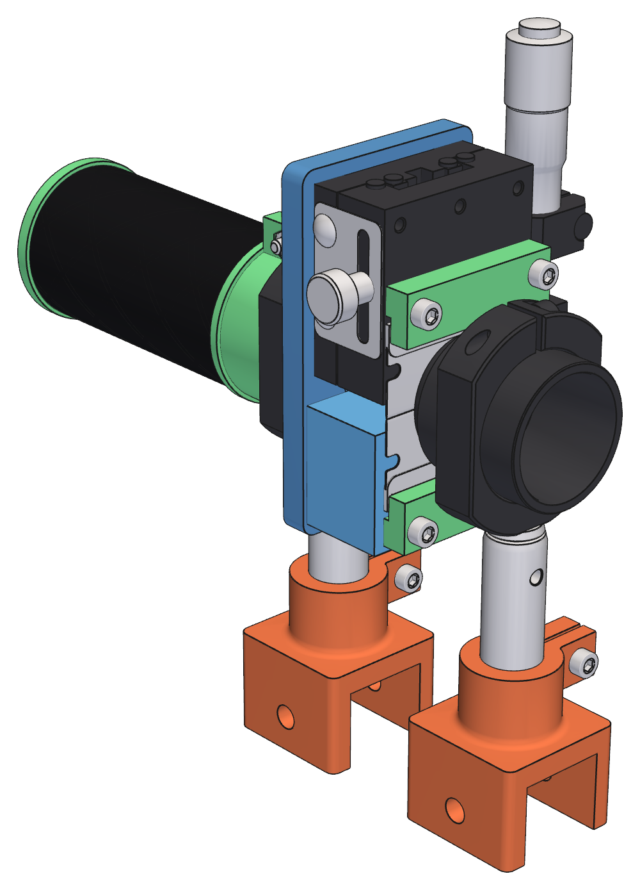

## 8. Field lens

The field lens makes every slit point's cone fill the mirror alike ([§6.3](06-light-source.md#63-condenser-optics)),
and the slit stands at the distance from the condenser at which the lens's focal length images the iris onto the
mirror. It is a Thorlabs LA1433-A, a Ø1 in N-BK7 plano-convex lens with f = 149.5 mm, on a post of its own ahead of the
blades, not on the slit head. Three reasons: the lens's alignment to the optical axis rests on the machined
metal parts of the common post stack ([§5](05-post-support.md#5-rail-mounted-posts)) and not on a printed
dimension; the lens does not turn with the head, so a decentering does not swing the illumination around when the
head is rotated; and the head's toe fingers only stop short of the tube ([§7.4](07-source-slit.md#74-blade-clamping)). The
model is `src/schlieren/parts/field_lens.py` (`uv run field-lens`, with `--show` for the viewer assembly), and
`uv run optical-head --no-field-lens` shows the head without it.

  
   
  <em>Fig. 11. Field lens station ahead of the slit head, with the head's post, seen from the mirror side</em>

**Stack.** The lens sits with its plano face on the internal lip of a Thorlabs SM1L10 lens tube, 3.81 mm from
the tube's thread end, and its convex face toward the mirror. The SM1RR retaining ring supplied with the tube
holds it from the open end; seat the ring with the optical spanner wrench. The tube is clamped by its full-diameter
section in a Thorlabs SM1RC/M split ring on a TR50/M post on the common shoe, the same stack as every other
station, so the lens is at the 22.1 mm post-top to axis dimension of the common post stack. The lens's object-side
principal plane lies 2.0 mm inside its plano face (the catalog focal length less the back focal length; the
drawing's 3.1 mm center thickness over the index of 1.52 agrees), the plane the iris distance of
[§6.3](06-light-source.md#63-condenser-optics) is measured to.

**Position.** The tube's thread end stands 0.5 mm above the tops of the blades' folds, between the toe fingers, whose
slit-side faces stand 1 mm clear of the tube's body ([§7.4](07-source-slit.md#74-blade-clamping)). The lens's plano face is
3.81 mm in from the thread end, about 5 mm ahead of the blade-seat plane (5.3 mm in the model). The tube is long
enough to carry the lens from a clamp ring that stands clear of the toe hardware, the reason for a tube in a split ring
rather than a one-piece lens mount: the toe bars (to 6 mm ahead of the blades) and their screw heads (to 9 mm) sweep
through the region around the axis. The screw heads set the post's position: they pass the post 2 mm clear
([§7.5](07-source-slit.md#75-rotation-mount-and-clearances)) at the head angle that puts one over it. The ring's slit-side face is
about 12 mm ahead of the blade plane and the post axis about 17 mm ahead, 52.0 mm from the slit head's post, which
leaves about 22 mm of rail between the shoes. The station along the rail is a setup value, set by sliding the
shoe, and the tube's position in its ring sets the lens's distance from the slit; neither is critical, since
2 mm either way moves the footprint from the end of the brightest portion on the mirror by about 1.4 mm (about 2.1 mm
from the shoulder's edge). The slit lies inside the lens's focal length, so the mirror sees a virtual slit image about
5 % larger than the slit and about 0.4 mm behind it, and the returned slit image at the cutoff is that much larger
([§10.3](10-camera-telephoto.md#103-alignment-requirements)). The beam at the lens is about 17 mm long, inside the tube's Ø24 mm bore at the lip and the retaining ring's Ø22.9 mm aperture.

**Alignment.** A lens decentered by δ shifts the whole illumination on the mirror by about 21 δ; with the lens
centered, every slit point's cone centers on the mirror. Mirror height corrects the component
of the shift across the slit, as for the slit-width shift of [§7.3](07-source-slit.md#73-slit-width); the component along the slit is
limited by the post stack's alignment. Opening the iris from Ø10.0 mm to its Ø12 mm maximum widens each footprint
by about 20 mm at the mirror, enough for a lens error of about 1 mm.

**Without the field lens.** To compare with and without it, loosen the SM1RC/M's M4 screw and slide the tube out of
the ring toward the mirror; the empty ring and post stand clear of the beam. Slide the tube back to restore the
lens, to within about 2 mm of its position. Slide the whole station away from the slit when the head is removed or
the focus target is fitted ([§7.7](07-source-slit.md#77-slit-focus-target)): the tube's thread end stands between the toe fingers, over the blades, where the
target's rim and ring go, and the paper is read from the mirror side. The lens does not change the focus of the LED
image on the slit plane.

**Provisional:** the lens's position and the iris setting rest on the iris-to-slit distance of about 150 mm
([§6.3](06-light-source.md#63-condenser-optics)), which is calculated from the stack and not measured; both are to be confirmed from a
flat-field photograph of the mirror illumination with the lens in place and removed.
